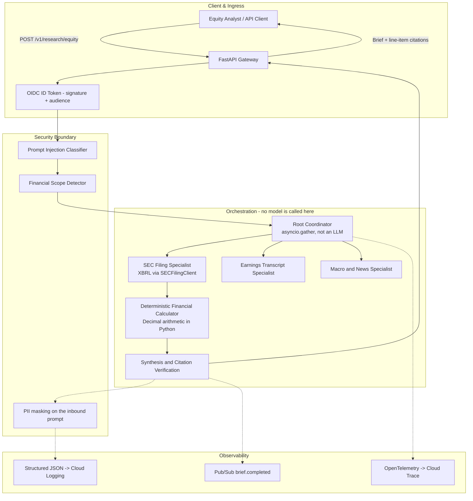
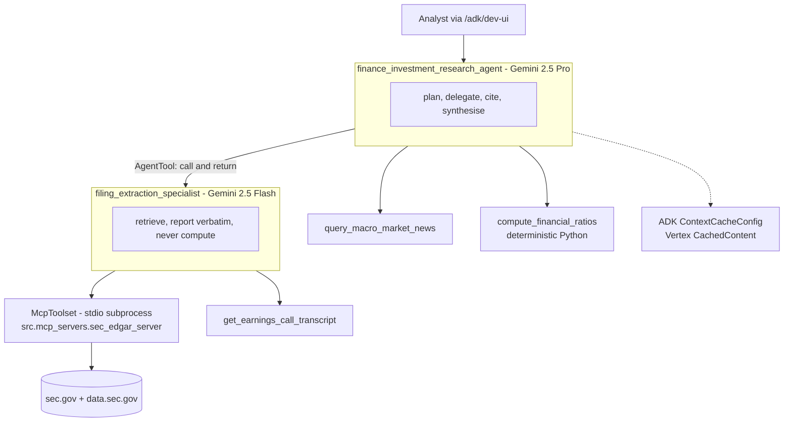

# Autonomous Investment Research Intelligence Agent (IRA)

[-4285F4.svg)](https://cloud.google.com/run)
[](https://cloud.google.com/vertex-ai)
[](https://github.com/delta-fde/itsadi-finance-investment-research-agent/actions/workflows/ci-lint-test.yml)
[](https://github.com/delta-fde/itsadi-finance-investment-research-agent/actions/workflows/eval-gate.yml)
[](LICENSE)
[](pyproject.toml)
[](tests/)

An enterprise multi-agent equity research platform built on **Google Cloud Platform** and the **Google Agent Development Kit (ADK)**. IRA automates equity due diligence over audited SEC filings (Forms 10-K, 10-Q, 8-K), quarterly earnings call transcripts, and curated macroeconomic context, and returns audit-ready briefs with **100% line-item citation provenance**.

Ticker resolution, filing lookup and XBRL extraction all happen **live against sec.gov** at request time. There is no pre-built index and no company whitelist: a registrant nobody has asked for before works exactly like one that has.

### Two execution paths

This is the first thing to understand about the system, because the two behave very differently and the distinction is easy to miss.

| | **REST** `POST /v1/research/equity` | **Agentic** `/adk` |
|---|---|---|
| Latency | **2–7s** | **45s warm, 71s typical, 169s cold** |
| Cost per brief | **$0.00** | **~$0.05** |
| LLM calls | **none** | Gemini 2.5 Pro + Flash |
| Reasoning | none — the figures are real, the prose is templated | genuine |
| Best for | reproducible numbers, regression suites, speed | analysis, follow-up questions, judgement |

Both read the same live SEC data through the same client and the same rate limiter. Figures quoted above were measured on the deployed service, not projected — see [Cost & Token Consumption Analysis](docs/cost_and_token_analysis.md).


---

## 🏛️ System Architecture

Both paths share the ingress, the guardrails and the SEC client. They diverge entirely at the orchestration layer.

### Path 1 — REST: deterministic pipeline



### Path 2 — ADK: agentic loop



`AgentTool` rather than `sub_agents` is deliberate: transfer would hand the conversation to Flash and leave it there, and the coordinator would never write the brief.

---


## ✨ Key Capabilities & Architectural Differentiators

- **Zero Arithmetic Hallucination:** General-purpose LLMs are forbidden from performing mental math. All financial growth rates, operating margins, FCF conversion ratios, and debt-to-equity multiples are calculated by a pure Python deterministic engine using IEEE 754-safe `Decimal` operations.
- **100% Evidentiary Line-Item Provenance:** Every stated numerical figure and executive claim links to an audited primary SEC Form 10-K filing or transcript quote with exact accession numbers, statement rows, or verbatim timestamps.
- **Asymmetric Model Routing:** The ADK agent is two agents. The coordinator plans and synthesises on **Gemini 2.5 Pro**; a `filing_extraction_specialist` reached through `AgentTool` pulls 10-K sections and transcripts on **Gemini 2.5 Flash**. Retrieval is where the tokens are and where the reasoning is not.
- **Gemini Context Caching:** Enabled through ADK's `ContextCacheConfig`, which calls Vertex's `CachedContent` API. Two honest caveats: nothing is cached on the first turn of a session, and Gemini will not cache a prefix under 2,048 tokens. Measured working on the deployed service — later turns in a session report 1,593 then 2,739 cached prompt tokens.
- **Measured, not projected:** ~21,700 tokens and **~$0.05** per agentic brief, against an earlier $0.165 projection. The asymmetric routing is what pays for itself: Flash handles retrieval for $0.0053 per brief where Pro would have cost $0.0215 — about **24% of total inference cost** saved. Read the token counts from Cloud Monitoring, not from the ADK response: `AgentTool` runs the specialist on a nested runner, so its usage never reaches the caller.
- **Pre-Execution Defense-in-Depth:** Incoming prompts are inspected for adversarial prompt injections (DAN jailbreaks, system prompt overrides) and financial domain boundaries before invoking LLMs or tools.
- **Enterprise Observability & Compliance:** Full-stack OpenTelemetry tracing exported to Google Cloud Trace, structured compliance audit logging emitted to Google Cloud Logging and exported to BigQuery by a logging sink (outside the request path, so a BigQuery outage cannot fail a brief), and asynchronous event broadcasting via Cloud Pub/Sub.

---

## 🚀 Quickstart & Local Development

### 1. Clone & Set Up Virtual Environment

```bash
git clone https://github.com/delta-fde/itsadi-finance-investment-research-agent.git
cd itsadi-finance-investment-research-agent

python3 -m venv .venv
source .venv/bin/activate
pip install --upgrade pip
pip install -e .[dev]
```

### 2. Configure Environment

```bash
cp .env.example .env
```

Settings are read from the environment by `src/config.py` (pydantic-settings).
There is no YAML config file: a second source of truth that the code never
loads is a file that silently drifts.

### 3. Run Automated Tests (90% Statement Coverage)

```bash
make test
# Or directly:
pytest --cov=src --cov-fail-under=80 --cov-report=term-missing -v
```

### 4. Run Golden Benchmark Evaluation Gate (52 Scenarios)

```bash
make eval
# Or directly:
python -m eval.regression_gate
```

### 5. Launch Local REST API

```bash
make run
# Access interactive documentation:
# Swagger UI: http://localhost:8080/docs
# ReDoc: http://localhost:8080/redoc
```

### 6. Launch the Streamlit Test Console

A rendered view of the brief — metrics with their formulas, citations with their
accession numbers, and a banner stating whether the revision is reading sec.gov
or the recorded corpus. `/docs` covers "can I call the endpoint"; this covers
"is the answer right".

```bash
make install-ui            # streamlit is an opt-in extra, never in the image
make run                   # in one terminal
make ui                    # in another -> http://localhost:8502

# against a deployed revision
make ui URL=https://ira-service-production-<hash>.us-central1.run.app
```

### 7. Launch the Agent (the path that actually reasons)

```bash
make adk-web     # ADK dev UI -> http://localhost:8000, watch every tool call
make adk-run     # same agent, terminal REPL
```

On the deployed service the same dev UI is mounted at `/adk/dev-ui/`, and the
session API at `/adk/apps/agents/users/{user}/sessions/{session}` + `/adk/run`.

> [!NOTE]
> `OFFLINE_MODE` defaults to **true** so that tests, CI and the eval gate are
> hermetic. Set `OFFLINE_MODE=false` to read sec.gov. You can always tell which
> is live: `/readyz` reports `runtime.offline_mode`, the Streamlit console shows
> a banner, and every payload carries a `data_source` field.

---

## ⚠️ Known Limitations

Stated here rather than left to be discovered.

- **The REST brief's prose is templated.** The numbers are real — XBRL tags,
  computed in Python — but the executive summary and risk matrix are fixed
  sentences filled with those figures. Only the `/adk` path reasons.
- **The agent path takes 45–71s** against a 60s design target. Measured, not
  estimated. Latency scales with the number of coordinator turns.
- **No load test.** Concurrency, `max_instances` and the autoscaling range are
  configuration only.
- **The eval gate scores offline.** Correct for a hermetic CI gate, but no
  live-path evaluation run is recorded.
- **Operating-income coverage is partial.** 18 of 43 tickers do not tag
  `OperatingIncomeLoss` — every bank, much of pharma. Those briefs omit
  operating margin rather than substituting a related tag, which is the correct
  answer and not a bug.
- **Vertex AI Vector Search was waived** in favour of context caching; see
  [ADR-003](docs/adrs/ADR-003-gemini-context-caching-vs-vector-rag.md).

---


## 📑 Project Documentation Index

- **Requirements & Discovery:**
  - [Functional Requirements Document (FRD / PRD)](docs/prd_functional_requirements.md)
  - [Financial Domain KPI Specification](docs/financial_kpi_specification.md)
  - [Data &amp; Deployment Discovery Document](docs/data_and_deployment_discovery.md)
  - [Grounding &amp; API Discovery Document](docs/grounding_and_api_discovery.md)
  - [Data Dictionary &amp; Schema Specification](docs/data_dictionary.md)
- **Architecture & Technical Design:**
  - [Technical Design Document (Part 1 - System Architecture)](docs/tdd_part1_system_architecture.md)
  - [Technical Design Document (Part 2 - Application Architecture)](docs/tdd_part2_application_architecture.md)
  - [OpenAPI 3.1 REST Specification](openapi.yaml)
  - [ADR-001: Multi-Agent Hierarchical Orchestration vs Monolithic ReAct](docs/adrs/ADR-001-multi-agent-hierarchical-orchestration.md)
  - [ADR-002: Model Context Protocol (MCP) Integration vs Proprietary Wrappers](docs/adrs/ADR-002-mcp-tool-integration.md)
  - [ADR-003: Gemini Context Caching vs Chunk-based Vector RAG](docs/adrs/ADR-003-gemini-context-caching-vs-vector-rag.md)
- **Evaluation & LLM Ops:**
  - [Golden Evaluation Dataset (52 Curated Scenarios)](datasets/golden_evaluation_dataset.json)
  - [Dataset Curation &amp; Annotation Guidelines](datasets/dataset_annotation_guidelines.md)
  - [Evaluation Baseline Report](docs/evaluation_baseline_report.md)
- **Operations & Reports:**
  - [Operational Runbook &amp; Incident Triage](docs/operational_runbook.md)
  - [Developer Setup &amp; Onboarding Guide](docs/developer_onboarding_guide.md)
  - [User &amp; API Demonstration Walkthrough](docs/user_demo_walkthrough.md)
  - [Product Readiness Review (PRR) Deck](docs/product_readiness_review_deck.md)
  - [Cost &amp; Token Consumption Analysis](docs/cost_and_token_analysis.md)
  - [Final Technical &amp; Business Summary Report](docs/final_project_report.md)

---

## 📄 License

This project is licensed under the Apache 2.0 License - see the [LICENSE](LICENSE) file for details.
