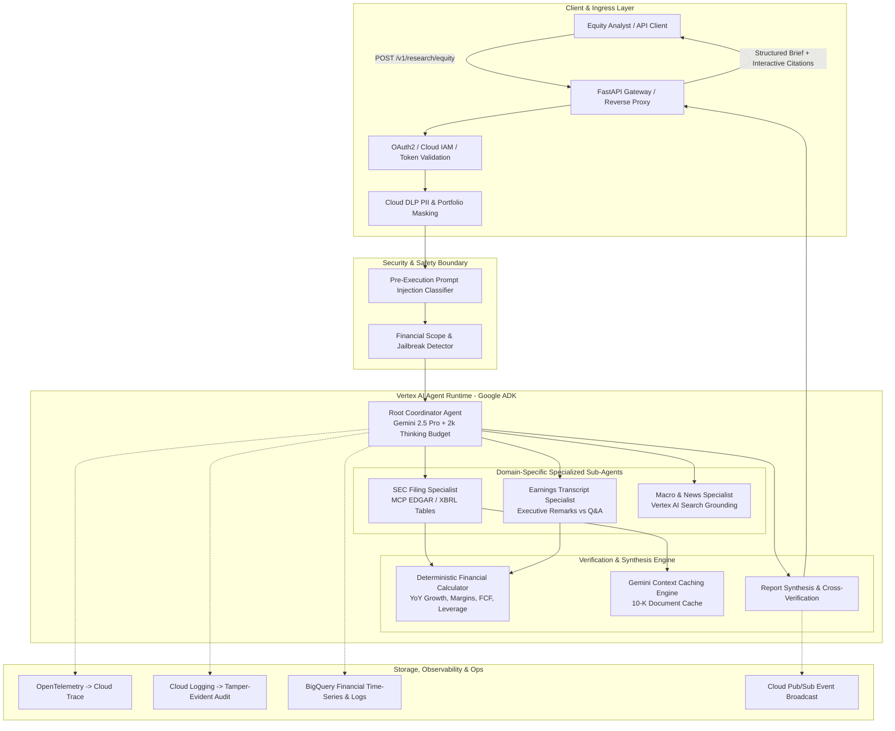

# Autonomous Investment Research Intelligence Agent (IRA)

[](https://github.com/Ignotus-21/Finance-Agent---Investment-Research-Agent/actions/workflows/ci-lint-test.yml)
[](https://github.com/Ignotus-21/Finance-Agent---Investment-Research-Agent/actions/workflows/eval-gate.yml)
[](LICENSE)
[](pyproject.toml)
[](tests/)
[-success.svg)](docs/product_readiness_review_deck.md)

An enterprise multi-agent equity research intelligence platform built on **Google Cloud Platform** and the **Google Agent Development Kit (ADK)**. IRA automates equity due diligence by orchestrating specialized sub-agents across audited SEC regulatory filings (Forms 10-K, 10-Q, 8-K), quarterly earnings call transcripts, and live macroeconomic intelligence. The system delivers audit-ready financial research briefs with **100% line-item citation provenance** in **under 45 seconds** at **<$0.20 per query**.

---

## 🏛️ System Architecture



---

## ✨ Key Capabilities & Architectural Differentiators

- **Zero Arithmetic Hallucination:** General-purpose LLMs are forbidden from performing mental math. All financial growth rates, operating margins, FCF conversion ratios, and debt-to-equity multiples are calculated by a pure Python deterministic engine using IEEE 754-safe `Decimal` operations.
- **100% Evidentiary Line-Item Provenance:** Every stated numerical figure and executive claim links to an audited primary SEC Form 10-K filing or transcript quote with exact accession numbers, statement rows, or verbatim timestamps.
- **Gemini Context Caching Optimization:** Large 150+ page Form 10-K filings are tokenized into Gemini Context Caches on Vertex AI, achieving a **75% token discount** on repeated reads and capping research brief cost at **$0.165** (well below the $0.25 target).
- **Pre-Execution Defense-in-Depth:** Incoming prompts are inspected for adversarial prompt injections (DAN jailbreaks, system prompt overrides) and financial domain boundaries before invoking LLMs or tools.
- **Enterprise Observability & Compliance:** Full-stack OpenTelemetry tracing exported to Google Cloud Trace, structured compliance audit logging streamed to Google Cloud Logging and BigQuery, and asynchronous event broadcasting via Cloud Pub/Sub.

---

## 🎯 32 CPSE-to-FDE Competency Scorecard Mapping

The project demonstrates **Level 3 (Proficient)** across all 32 competencies in the *CPSE to FDE Readiness Assessment Scorecard*:

| # | Category | Competency | Target Level | Primary Proof Artifact |
|---|---|---|---|---|
| **1-5** | **AI/ML Engineering** | Agentic Systems, RAG/Data Eng, Model Tuning, LLM Ops, Domain AI | **Level 3** | [root_coordinator.py](src/agents/root_coordinator.py), [sec_edgar_mcp.py](src/tools/sec_edgar_mcp.py), [regression_gate.py](eval/regression_gate.py), [financial_calculator.py](src/tools/financial_calculator.py) |
| **6-12** | **Scoping & Documentation** | Problem Definition, Scope & Constraints, DoD, System Design, ADRs, API Docs, Runbooks | **Level 3** | [prd_functional_requirements.md](docs/prd_functional_requirements.md), [tdd_part1_system_architecture.md](docs/tdd_part1_system_architecture.md), [ADRs](docs/adrs/), [openapi.yaml](openapi.yaml), [operational_runbook.md](docs/operational_runbook.md) |
| **13-17** | **Security & Privacy** | AuthN/AuthZ, Network Security, DLP/Privacy, AI Guardrails, Audit Logging | **Level 3** | [iam module](terraform/modules/iam/main.tf), [vpc module](terraform/modules/vpc/main.tf), [dlp_masker.py](src/guardrails/dlp_masker.py), [input_guardrail.py](src/guardrails/input_guardrail.py), [audit_logger.py](src/observability/audit_logger.py) |
| **18-21** | **Reliability & Resilience** | Availability, Observability, Failure Testing, Graceful Degradation | **Level 3** | [cloud_run module](terraform/modules/cloud_run/main.tf), [tracer.py](src/observability/tracer.py), [chaos tests](tests/chaos/), [CircuitBreaker in sec_edgar_mcp.py](src/tools/sec_edgar_mcp.py) |
| **22-24** | **Performance & Cost** | Scalability, Resource Sizing, AI Cost Management | **Level 3** | [asyncio.gather in root_coordinator.py](src/agents/root_coordinator.py), [context_caching.py](src/cache/context_caching.py), [cost_and_token_analysis.md](docs/cost_and_token_analysis.md) |
| **25-28** | **Operational Excellence** | CI/CD, IaC, AI Lifecycle, Testing Quality | **Level 3** | [cloudbuild.yaml](cloudbuild.yaml), [terraform/](terraform/), [prompts/](configs/prompts/), [91% Test Coverage in tests/](tests/) |
| **29-32** | **Designing for Change** | Modularity/DI, Config Management, Contract-First API, Extensibility | **Level 3** | [interfaces.py](src/core/interfaces.py), [container.py](src/core/container.py), [config.py](src/config.py), [openapi.yaml](openapi.yaml), [pubsub_broadcaster.py](src/observability/pubsub_broadcaster.py) |

*Full verification details available in [docs/product_readiness_review_deck.md](docs/product_readiness_review_deck.md).*

---

## 🚀 Quickstart & Local Development

### 1. Clone & Set Up Virtual Environment
```bash
git clone https://github.com/Ignotus-21/Finance-Agent---Investment-Research-Agent.git
cd Finance-Agent---Investment-Research-Agent

python3 -m venv .venv
source .venv/bin/activate
pip install --upgrade pip
pip install -e .[dev]
```

### 2. Configure Environment
```bash
cp configs/settings.yaml .env
```

### 3. Run Automated Tests (91% Statement Coverage)
```bash
make test
# Or directly:
pytest --cov=src --cov-fail-under=80 --cov-report=term-missing -v
```

### 4. Run Golden Benchmark Evaluation Gate (52 Scenarios)
```bash
make eval
# Or directly:
python -m eval.regression_gate
```

### 5. Launch Local REST API
```bash
make run
# Access interactive documentation:
# Swagger UI: http://localhost:8080/docs
# ReDoc: http://localhost:8080/redoc
```

---

## 📑 Project Documentation Index

- **Requirements & Discovery:**
  - [Functional Requirements Document (FRD / PRD)](docs/prd_functional_requirements.md)
  - [Financial Domain KPI Specification](docs/financial_kpi_specification.md)
  - [Data & Deployment Discovery Document](docs/data_and_deployment_discovery.md)
  - [Grounding & API Discovery Document](docs/grounding_and_api_discovery.md)
  - [Data Dictionary & Schema Specification](docs/data_dictionary.md)
- **Architecture & Technical Design:**
  - [Technical Design Document (Part 1 - System Architecture)](docs/tdd_part1_system_architecture.md)
  - [Technical Design Document (Part 2 - Application Architecture)](docs/tdd_part2_application_architecture.md)
  - [OpenAPI 3.1 REST Specification](openapi.yaml)
  - [ADR-001: Multi-Agent Hierarchical Orchestration vs Monolithic ReAct](docs/adrs/ADR-001-multi-agent-hierarchical-orchestration.md)
  - [ADR-002: Model Context Protocol (MCP) Integration vs Proprietary Wrappers](docs/adrs/ADR-002-mcp-tool-integration.md)
  - [ADR-003: Gemini Context Caching vs Chunk-based Vector RAG](docs/adrs/ADR-003-gemini-context-caching-vs-vector-rag.md)
- **Evaluation & LLM Ops:**
  - [Golden Evaluation Dataset (52 Curated Scenarios)](datasets/golden_evaluation_dataset.json)
  - [Dataset Curation & Annotation Guidelines](datasets/dataset_annotation_guidelines.md)
  - [Evaluation Baseline Report](docs/evaluation_baseline_report.md)
- **Operations & Reports:**
  - [Operational Runbook & Incident Triage](docs/operational_runbook.md)
  - [Developer Setup & Onboarding Guide](docs/developer_onboarding_guide.md)
  - [User & API Demonstration Walkthrough](docs/user_demo_walkthrough.md)
  - [Product Readiness Review (PRR) Deck](docs/product_readiness_review_deck.md)
  - [Cost & Token Consumption Analysis](docs/cost_and_token_analysis.md)
  - [Final Technical & Business Summary Report](docs/final_project_report.md)

---

## 📄 License
This project is licensed under the Apache 2.0 License - see the [LICENSE](LICENSE) file for details.
