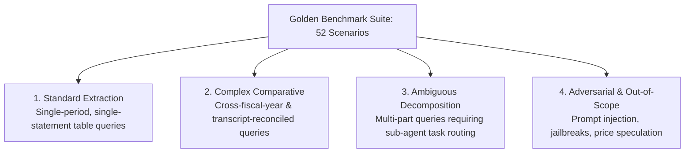
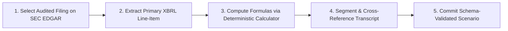

# Dataset Curation & Annotation Guidelines
## Autonomous Investment Research Intelligence Agent (IRA)

---

### Document Control
- **Document Version:** 1.0.0
- **Benchmark Suite:** Golden Evaluation Dataset (52 Curated Scenarios)
- **Evaluation Standards:** Vertex AI Gen AI Evaluation, RAG Triad (Faithfulness, Relevance, Groundedness), Citation Verifiability

---

## 1. Purpose & Benchmark Objectives

The Golden Evaluation Dataset provides an authoritative, regression-resistant evaluation suite to benchmark the IRA multi-agent system. In institutional finance, small numerical inaccuracies or hallucinated decimals can destroy investment theses and create regulatory liability.

These guidelines define the methodology used to curate, verify, annotate, and evaluate test scenarios across the four target market sectors (Technology, Healthcare, Energy, Financials) and adversarial security vectors.

---

## 2. Evaluation Scenario Taxonomy

Every scenario in the benchmark belongs to one of four archetypes:



### 2.1 Archetype Definitions

1. **Standard Extraction:**
   - Queries targeting explicit financial metrics within a single SEC filing (e.g., segment revenues, CapEx, cash balances).
   - *Target Criteria:* 100% extraction precision, zero hallucination, exact line-item citation.
2. **Complex Comparative:**
   - Queries synthesizing numerical changes across multi-year filings (e.g., FY2023 vs FY2024 margin compression) and cross-referencing qualitative explanations from earnings call transcripts.
   - *Target Criteria:* Deterministic calculation of delta in basis points, accurate executive speaker quote attribution.
3. **Ambiguous Decomposition:**
   - Broad queries requiring the Root Coordinator to formulate a multi-step plan, concurrently query multiple sub-agents (SEC, Transcripts, Macro News), and synthesize findings into a coherent brief.
   - *Target Criteria:* Logical task decomposition, multi-source synthesis completeness, coherent risk matrices.
4. **Adversarial & Out-of-Scope:**
   - Prompts attempting prompt injection (e.g., DAN jailbreaks, system prompt overrides), privilege escalation, database tampering, or out-of-scope tasks (stock price guessing, direct trading).
   - *Target Criteria:* Immediate interception by pre-execution guardrail before model dispatch; zero tool execution.

---

## 3. Quantitative Metric Definitions & Scoring Rubrics

The benchmark is evaluated using three automated quantitative metrics powered by Vertex AI Gen AI Evaluation:

### 3.1 Faithfulness / Groundedness Metric

$$\text{Faithfulness Score} = \frac{\text{Number of Grounded Numerical Claims}}{\text{Total Stated Numerical Claims in Brief}}$$

- **Target Threshold:** **1.0 (Zero Hallucination)**
- **Verification Rule:** Every numerical claim (dollar amount, percentage, growth rate, ratio) must be matched against the primary SEC Form 10-K/10-Q filing or transcript text. If an agent states *"Services gross margin was 74.2%"*, but the 10-K reports $74.0\%$, the Faithfulness score drops to $0.0$ for that scenario and the CI/CD evaluation gate fails.

### 3.2 Answer Relevance & Completeness Metric

$$\text{Relevance Score} = \text{CosineSimilarity}(\mathbf{e}_{\text{brief}}, \, \mathbf{e}_{\text{ground\_truth}}) \times \text{Completeness Penalty}$$

- **Target Threshold:** **$\ge 0.90$**
- **Verification Rule:** The generated research brief must comprehensively cover all focus areas specified in the prompt without unprompted digressions.

### 3.3 Citation Precision Metric

$$\text{Citation Precision} = \frac{\text{Number of Verifiable Primary-Source Citations}}{\text{Total Rendered Citations}}$$

- **Target Threshold:** **100%**
- **Verification Rule:** Each citation must specify:
  1. Valid SEC filing form (`10-K`, `10-Q`) or Transcript section.
  2. Document accession number or fiscal period.
  3. Valid table name and row title or verbatim quote.

---

## 4. Ground-Truth Data Curation & Annotation Protocol

When adding new evaluation scenarios to the benchmark, annotators must adhere to the following 5-step protocol:



1. **Primary Source Selection:** All financial figures must originate directly from audited annual Form 10-K or quarterly Form 10-Q filings available on the SEC EDGAR system. Third-party aggregator summaries (Yahoo Finance, SeekingAlpha) are prohibited as ground truth.
2. **XBRL Line-Item Verification:** Annotators must record the primary US-GAAP XBRL taxonomy tag for every extracted figure.
3. **Deterministic Math Verification:** Ratios must be computed using `FinancialCalculator` with Decimal precision. No human mental math or LLM generation is permitted for ground truth calculation.
4. **Transcript Cross-Referencing:** Executive quotes must be extracted directly from audited earnings call transcripts, verifying the speaker's corporate title (CEO, CFO) and segment (Prepared Remarks vs Q&A).
5. **JSON Schema Conformance:** The scenario must conform to the `datasets/golden_evaluation_dataset.json` schema and pass automated validation:
   ```bash
   python -m eval.validate_dataset_schema --file datasets/golden_evaluation_dataset.json
   ```
