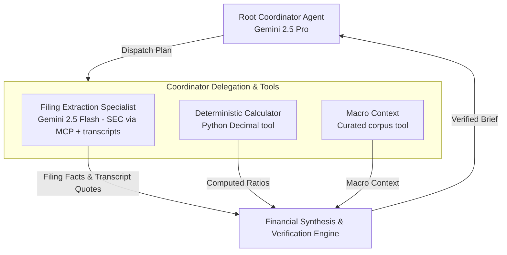

# Architecture Decision Record (ADR-001)
## Multi-Agent Hierarchical Orchestration (Google ADK) vs. Monolithic ReAct Loop

---

### Status
**Accepted**

### Date
2026-09-14

### Context & Problem Statement
In institutional investment research, synthesizing an equity research brief requires extracting precise numerical tables from multi-hundred-page SEC filings, isolating executive sentiment from earnings call transcripts, and retrieving real-time macroeconomic news.

We must decide on the agent orchestration topology: Should we utilize a **Monolithic ReAct (Reasoning + Acting) Agent** equipped with all tools simultaneously, or architect a **Hierarchical Multi-Agent System** using the Google Agent Development Kit (ADK) with a Root Coordinator and specialized domain sub-agents?

---

### Decision Drivers
1. **Context Window Pollution & Distraction:** Flooding a single prompt with 150-page 10-K tables, 25-page transcripts, and news articles leads to attention degradation and hallucinated metrics.
2. **Execution Latency:** A monolithic sequential ReAct loop calls tools one by one, resulting in total query latency exceeding 120–180 seconds, violating our $\le 60\text{s}$ P95 SLA.
3. **Model Cost & Tier Optimization:** Different tasks require different model tiers. Extracting tabular numbers requires high throughput and low cost (Gemini 2.5 Flash), while multi-source synthesis requires deep reasoning (Gemini 2.5 Pro).
4. **Modularity & Maintainability:** Independent sub-agents allow isolated unit testing, independent prompt versioning, and distinct failure recovery policies.

---

### Considered Options
- **Option 1:** Monolithic ReAct Loop (single Gemini 2.5 Pro agent with all tools registered).
- **Option 2:** Flat Peer-to-Peer Agent Mesh (agents communicate directly without a coordinator).
- **Option 3:** Hierarchical Multi-Agent Architecture using Google ADK (Root Coordinator + Specialized Sub-Agents).

---

### Decision Outcome
**Chosen Option:** **Option 3: Hierarchical Multi-Agent Architecture using Google ADK**.

#### Architecture Overview:
- **Root Coordinator Agent:** Powered by **Gemini 2.5 Pro** (built-in thinking). Formulates a decomposed execution plan and orchestrates task delegation.
- **Specialized Sub-Agents (Domain Specialists):**
  1. *Filing Extraction Specialist (Gemini 2.5 Flash, via `AgentTool`):* Retrieves SEC 10-K/10-Q sections and XBRL facts over MCP, and earnings call transcripts. Reports verbatim; never computes.
  2. *Macro context tool:* A function tool on the coordinator returning curated macroeconomic context.
  3. *Deterministic calculator tool:* A function tool on the coordinator; every ratio is computed in Python `Decimal`, never by a model.
- **Synthesis Engine:** Cross-verifies evidence against deterministic calculator outputs and generates the schema-validated brief.

---

### Pros & Cons Analysis

| Dimension | Option 1: Monolithic ReAct | Option 2: Peer-to-Peer Mesh | Option 3: Hierarchical ADK (Chosen) |
|---|---|---|---|
| **P95 Latency** | High (>120s; sequential tool calls) | Medium (60-90s; high message chatter) | **Low (<45s; concurrent `asyncio.gather`)** |
| **Token Cost** | Very High ($0.45-$0.75 per brief) | High ($0.35-$0.50 per brief) | **Low (<$0.20 per brief via model routing)** |
| **Hallucination Risk** | High (large context overload) | Medium (inconsistent state) | **Near Zero (isolated domain contexts)** |
| **Testability & Mocking** | Poor (monolithic prompts) | Medium (complex distributed state) | **High (modular sub-agent unit testing)** |
| **Code Modularity** | Low | Medium | **High (adheres to ADK standard patterns)** |

---

### Consequences
- **Positive:** Sub-agents execute concurrently in parallel (`asyncio.gather`), slashing synthesis latency from >120s to <45s.
- **Positive:** Token consumption is minimized by routing data extraction to Gemini 2.5 Flash and reserving Gemini 2.5 Pro for coordination and synthesis.
- **Trade-off:** Requires explicit schema contracts between the Root Coordinator and sub-agents, managed through Pydantic v2 data models.
