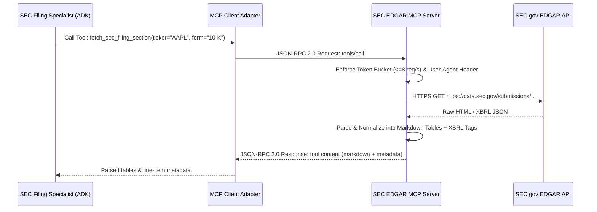

# Architecture Decision Record (ADR-002)
## Model Context Protocol (MCP) Tool Integration vs. Proprietary REST Wrappers

---

### Status
**Accepted**

### Date
2026-09-14

### Context & Problem Statement
The SEC Filing Specialist sub-agent requires access to SEC EDGAR submissions, XBRL company facts, and filing sections (10-K, 10-Q, 8-K). Traditionally, engineering teams build ad-hoc Python wrapper functions wrapping `requests` or `httpx` to parse SEC endpoints. 

However, open tool ecosystems increasingly converge around the **Model Context Protocol (MCP)**, an open standard created to standardize how LLMs discover, inspect, and invoke external tools and resources across process boundaries.

We must decide whether to build proprietary in-house REST wrappers or adopt the Model Context Protocol (MCP) standard for SEC data integration.

---

### Decision Drivers
1. **Standardization & Portability:** Avoid proprietary tool lock-in; enable easy swapping of underlying data providers without altering agent prompts or schemas.
2. **Dynamic Tool Discovery:** MCP enables agents to inspect tool parameters, descriptions, and schema contracts dynamically at runtime via JSON-RPC.
3. **Process Isolation & Security:** Running external tools as MCP subprocesses or isolated servers prevents unvetted third-party scrapers from accessing the agent's main memory space.
4. **SEC Rate-Limit Enforceability:** Centralizing SEC EDGAR calls in an MCP server allows localized rate-limiting (token bucket cap at 8 req/s) and compliance header enforcement.

---

### Considered Options
- **Option 1:** Proprietary Python REST Wrappers (monolithic inline `httpx` calls in agent code).
- **Option 2:** LangChain / LlamaIndex Custom Tools (framework-specific tool classes).
- **Option 3:** Model Context Protocol (MCP) Client/Server Architecture.

---

### Decision Outcome
**Chosen Option:** **Option 3: Model Context Protocol (MCP) Client/Server Architecture**.

#### Architecture Overview:
The SEC integration is architected as an **MCP Server** exposing standardized tools (`fetch_sec_filing_section`, `get_company_facts_xbrl`) over `stdio` transport. The SEC Filing Specialist agent connects as an **MCP Client**, inspecting schemas and executing tool calls through JSON-RPC 2.0.

---

### Pros & Cons Analysis

| Dimension | Option 1: Proprietary REST | Option 2: Framework Custom Tools | Option 3: MCP Architecture (Chosen) |
|---|---|---|---|
| **Industry Standardization** | None (ad-hoc code) | Framework-locked | **Open Industry Standard (MCP)** |
| **Tool Reusability** | Zero outside this codebase | Limited to same framework | **Universal across any MCP-compliant agent** |
| **Security Isolation** | In-process execution | In-process execution | **Process boundary isolation** |
| **Maintenance Overhead** | High custom maintenance | High framework churn | **Standard protocol lifecycle** |

---

### Consequences
- **Positive:** Complies with modern enterprise AI standards; decouples the multi-agent reasoning layer from the physical SEC ingestion mechanics.
- **Positive:** The MCP server handles all SEC-specific compliance constraints (User-Agent formatting, rate limiting, retry backoff) in one dedicated component.
- **Trade-off:** Introduces a lightweight JSON-RPC communication boundary, adding negligible sub-millisecond serialization overhead.
