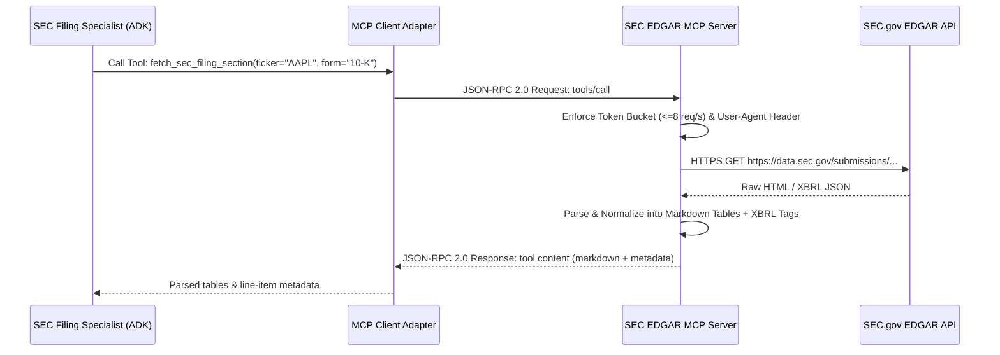

# Architecture Decision Record (ADR-002)
## Model Context Protocol (MCP) Tool Integration vs. Proprietary REST Wrappers

---

### Status
**Accepted**

### Date
2026-09-14

### Context & Problem Statement
The SEC Filing Specialist sub-agent requires access to SEC EDGAR submissions, XBRL company facts, and filing sections (10-K, 10-Q, 8-K). Traditionally, engineering teams build ad-hoc Python wrapper functions wrapping `requests` or `httpx` to parse SEC endpoints.

However, open tool ecosystems increasingly converge around the **Model Context Protocol (MCP)**, an open standard created to standardize how LLMs discover, inspect, and invoke external tools and resources across process boundaries.

We must decide whether to build proprietary in-house REST wrappers or adopt the Model Context Protocol (MCP) standard for SEC data integration.

---

### Decision Drivers
1. **Standardization & Portability:** Avoid proprietary tool lock-in; enable easy swapping of underlying data providers without altering agent prompts or schemas.
2. **Dynamic Tool Discovery:** MCP enables agents to inspect tool parameters, descriptions, and schema contracts dynamically at runtime via JSON-RPC.
3. **Process Isolation & Security:** Running external tools as MCP subprocesses or isolated servers prevents unvetted third-party scrapers from accessing the agent's main memory space.
4. **SEC Rate-Limit Enforceability:** Centralizing SEC EDGAR calls in an MCP server allows localized rate-limiting (token bucket cap at 8 req/s) and compliance header enforcement.

---

### Considered Options
- **Option 1:** Proprietary Python REST Wrappers (monolithic inline `httpx` calls in agent code).
- **Option 2:** LangChain / LlamaIndex Custom Tools (framework-specific tool classes).
- **Option 3:** Model Context Protocol (MCP) Client/Server Architecture.

---

### Decision Outcome
**Chosen Option:** **Option 3: Model Context Protocol (MCP) Client/Server Architecture**.

#### Architecture Overview:
The SEC integration is architected as an **MCP Server** exposing standardized tools (`fetch_sec_filing_section`, `get_company_facts_xbrl`) over `stdio` transport. The SEC Filing Specialist agent connects as an **MCP Client**, inspecting schemas and executing tool calls through JSON-RPC 2.0.

---

### Pros & Cons Analysis

| Dimension | Option 1: Proprietary REST | Option 2: Framework Custom Tools | Option 3: MCP Architecture (Chosen) |
|---|---|---|---|
| **Industry Standardization** | None (ad-hoc code) | Framework-locked | **Open Industry Standard (MCP)** |
| **Tool Reusability** | Zero outside this codebase | Limited to same framework | **Universal across any MCP-compliant agent** |
| **Security Isolation** | In-process execution | In-process execution | **Process boundary isolation** |
| **Maintenance Overhead** | High custom maintenance | High framework churn | **Standard protocol lifecycle** |

---

### Consequences
- **Positive:** Complies with modern enterprise AI standards; decouples the multi-agent reasoning layer from the physical SEC ingestion mechanics.
- **Positive:** The MCP server handles all SEC-specific compliance constraints (User-Agent formatting, rate limiting, retry backoff) in one dedicated component.
- **Trade-off:** Introduces a lightweight JSON-RPC communication boundary, adding negligible sub-millisecond serialization overhead.

---

### Implementation Status (2026-09-16)

This ADR was accepted on 2026-09-14, but until 2026-09-16 no MCP protocol was
actually spoken anywhere in the codebase. `src/tools/sec_edgar_mcp.py` was an
ordinary Python class that the agent imported and called in-process; "MCP"
appeared only in the filename. The decision above was therefore **recorded but
not implemented**, and none of the claimed properties - process isolation,
dynamic discovery, protocol-level portability - were real.

The gap is now closed:

| Component | Location |
|---|---|
| MCP server (stdio, 2 tools) | [`src/mcp_servers/sec_edgar_server.py`](../../src/mcp_servers/sec_edgar_server.py) |
| MCP client wiring (`MCPToolset`) | `create_sec_edgar_mcp_toolset()` in [`src/agents/adk_agent.py`](../../src/agents/adk_agent.py) |
| End-to-end protocol tests | [`tests/integration/test_mcp_sec_edgar_server.py`](../../tests/integration/test_mcp_sec_edgar_server.py) |

The tests drive a real subprocess through a real handshake rather than calling
the tool functions directly, because in-process calls would re-test retrieval
logic that is already covered and would prove nothing about the transport.

#### Deltas from the design above

**Tool naming.** The second tool is `extract_xbrl_financial_facts`, not
`get_company_facts_xbrl` as written above. The agent instruction and the prior
in-process tool already used the former name; renaming to match this document
would have changed the model-visible contract for no benefit.

**Scope: SEC only.** The transcript, macro-search and financial-calculator
tools remain native ADK function tools and are deliberately *not* exposed over
MCP. The decision drivers listed above - third-party provider swapping, SEC
rate-limit centralisation, isolation of unvetted scrapers - are specific to SEC
ingestion. The calculator in particular is pure local arithmetic over numbers
the agent already holds, so a subprocess hop would add latency and a failure
mode while buying nothing. Applying MCP uniformly would be consistency for its
own sake.

**One implementation, two callers.** The MCP server wraps the existing
`SECFilingClient` rather than reimplementing retrieval. The REST API path and
the agent path therefore share one code path, one token bucket and one circuit
breaker. Writing a second SEC client behind the protocol boundary would have
satisfied the ADR literally while creating exactly the drift risk the ADR
exists to prevent.

**Rate limiting is per-process, not global.** The token bucket lives in the
server process, so it bounds that process only. With a single stdio subprocess
per agent this is equivalent to the intended behaviour, but it does **not**
hold across horizontally scaled Cloud Run instances - each replica gets its own
8 req/s budget. Enforcing the SEC limit fleet-wide would need shared state and
is out of scope here; the practical mitigation is that replica count stays low
and the circuit breaker absorbs upstream 429s.

**Transport: stdio, not SSE/HTTP.** The agent and the server share a lifecycle
and a trust boundary, so there is no reason to open a listening port - and not
opening one removes an entire class of exposure. The ADR's claim of "process
boundary isolation" holds; the claim of cross-network portability does not, and
would require switching to `SseConnectionParams` if ever needed.
