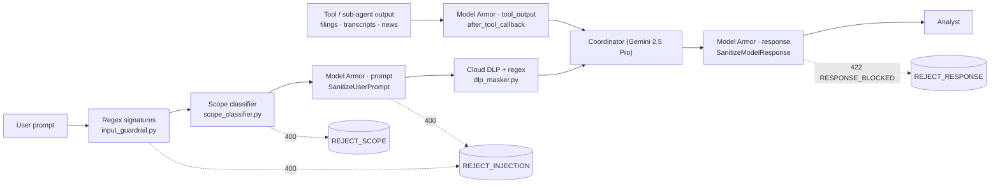

# Architecture Decision Record (ADR-004)
## Layered Guardrails: Regex Signatures, Model Armor, and Cloud DLP

---

### Status
**Accepted**

### Date
2026-11-11

### Context & Problem Statement
The agent accepts free-text analyst queries, feeds retrieved third-party content (SEC filings, earnings transcripts, Google-Search-grounded news) to Gemini, and returns prose that can drive capital allocation decisions. The specification requires pre-execution classifier callbacks that intercept 100% of adversarial prompt-injection and jailbreak attempts before tool dispatch, and Cloud DLP redaction of analyst identifiers and proprietary portfolio metadata (`threat_model.md` §4).

Three questions had to be settled: which detection mechanism(s) to use for prompt injection, where PII redaction should live, and which points in the request lifecycle to screen. The answer had to hold for both execution paths — the deterministic REST gateway (`/v1/research/equity`) and the LLM-driven ADK surface (`adk web`, `/adk`).

---

### Decision Drivers
1. **Determinism where the evaluation gate needs it:** the 52-scenario regression gate asserts a 100% guardrail interception rate offline and in CI; the primary interception layer must be reproducible without network access.
2. **Coverage of paraphrase:** signatures cannot match novel phrasings ("you are now in developer mode…"); a semantic classifier is required for residual risk R1.
3. **Indirect prompt injection:** retrieved filings and news are attacker-influenceable; content must be screened before a model reads it (risk R2).
4. **Availability over strictness, observably:** a guardrail outage must not take the research service down silently; degradation must be logged and the posture reversible per environment.
5. **One owner per concern:** PII redaction needs custom infoTypes (fund IDs, position sizes) and must preserve executive names in legitimate questions.
6. **Cost and latency:** paid, networked checks run only on input that already passed the free checks; per-request overhead stays within the 60 s P95 SLO.

---

### Considered Options
- **Option 1:** Regex signatures and a scope classifier only (in-process).
- **Option 2:** Model Armor only, at ingress.
- **Option 3:** Gemini `safety_settings` only (model-side).
- **Option 4:** LLM-as-judge classifier (a Gemini Flash call that grades each prompt).
- **Option 5:** Layered chain — regex signatures → scope classifier → Model Armor → Cloud DLP at ingress; Model Armor on tool output and on egress; Gemini `safety_settings` retained as the model-side floor.

For PII redaction specifically:
- **Option A:** Regex masker only.
- **Option B:** Model Armor Sensitive Data Protection (SDP) filter on the same template.
- **Option C:** Cloud DLP `deidentifyContent` with built-in + custom infoTypes, regex as second pass.

---

### Decision Outcome
**Chosen Option:** **Option 5** for injection defence and **Option C** for PII redaction.

**Ordering is by cost.** The free, deterministic layers reject the known phrasings in 0 ms and never spend a network call; Model Armor is invoked only for prompts that passed them; DLP runs last, on a prompt the system has decided to process.

**Stage-specific block policy** (`model_armor.BLOCK_POLICY`):

| Stage | API | Blocks on | Rationale |
|---|---|---|---|
| `prompt` | `SanitizeUserPrompt` | any filter match | the analyst can rephrase |
| `tool_output` | `SanitizeUserPrompt` | prompt-injection/jailbreak, malicious URI, SDP, CSAM — **not** Responsible AI | filings legitimately describe hazardous operations, litigation and adverse drug events; withholding them for an RAI match would blind the analysis. RAI matches are logged |
| `response` | `SanitizeModelResponse` (prompt passed as context) | any filter match | model output must not carry regurgitated injection, harmful content or malicious links |

Withheld tool output is replaced by a structured notice (`status: withheld`, tool name, matched filters) instructing the model to treat the evidence as unavailable rather than reconstruct it.

**Failure posture:** 3 s timeout; API error → `ModelArmorVerdict(degraded=True)` with a `model_armor_degraded` event. Default is fail-open (the in-process layers remain active); `MODEL_ARMOR_FAIL_CLOSED=true` rejects instead. Risk R8 in the register.

**Template:** one template per environment (`ira-prompt-guard-<env>`) with prompt-injection/jailbreak and malicious-URI filters and four RAI categories at `MEDIUM_AND_ABOVE`; SDP deliberately off. Created by `scripts/model_armor_template.sh` because provider `hashicorp/google ~> 5.38` has no Model Armor resource; Terraform enables the API, grants `roles/modelarmor.user`, and injects `ENABLE_MODEL_ARMOR` / `MODEL_ARMOR_TEMPLATE`.

---

### Pros & Cons Analysis

| Dimension | Option 1: Regex only | Option 2: Model Armor only | Option 3: Safety settings only | Option 4: LLM-as-judge | Option 5: Layered (Chosen) |
|---|---|---|---|---|---|
| **Paraphrase coverage** | None | Good | Poor (content safety, not injection) | Good | **Good** |
| **Offline / CI determinism** | Full | None (network) | None | None | **Full for the gate-critical layer** |
| **Indirect injection (tool output)** | No | Only if wired per stage | No | Costly per tool call | **Yes, policy-tuned** |
| **Egress screening** | No | Possible | Partial (generation-time) | Costly | **Yes** |
| **Latency per request** | 0 ms | ~150–300 ms | 0 ms | 1–3 s | **0 ms on rejects; ~150–300 ms per stage on accepted prompts** |
| **Failure mode** | n/a | Outage = no guardrail | n/a | Outage = no guardrail | **Degrades to regex + scope, logged** |
| **Operational cost** | None | Per request | None | Per request (tokens) | **Per accepted request, bounded by trusted-tool allowlist** |

| PII dimension | Option A: Regex | Option B: Model Armor SDP | Option C: Cloud DLP + regex (Chosen) |
|---|---|---|---|
| **Custom infoTypes (fund IDs, position sizes)** | Yes | Limited (basic SDP) | **Yes** |
| **Preserve executive names** | Yes | Not configurable in basic mode | **Yes (PERSON_NAME excluded)** |
| **Managed detector quality** | No | Yes | **Yes** |
| **Separation of concerns** | — | Couples redaction to the injection template | **Dedicated service, dedicated IAM role** |

---

### Consequences
- **Positive:** both execution paths share one guardrail object and one policy; the ADK surface cannot bypass it (`before_model_callback`, `after_tool_callback`, `after_model_callback`).
- **Positive:** residual risk R1 (novel phrasing) and R2 (indirect injection) both drop to Low; the architectural backstop (tool-sourced facts, deterministic arithmetic, citation verification) still bounds the worst case to a refusal or an uncited answer.
- **Trade-off:** +150–300 ms per Model Armor stage on accepted prompts and per screened tool call (≈ 1–3 s on a full ADK research run); `compute_financial_ratios` is allow-listed because its output is derived solely from its arguments.
- **Trade-off:** one regional dependency and one resource outside Terraform (the template); both are documented in the demo playbook and runbook.
- **Accepted risk:** fail-open default means a Model Armor outage silently reduces coverage to the in-process layers (R8); it is observable and reversible per environment.

---

### Production Implementation Architecture

| Component | Location |
|---|---|
| Regex signatures, scope classifier, stage entry points | [`src/guardrails/input_guardrail.py`](../../src/guardrails/input_guardrail.py), [`src/guardrails/scope_classifier.py`](../../src/guardrails/scope_classifier.py) |
| Model Armor client, stages, block policy, chunking | [`src/guardrails/model_armor.py`](../../src/guardrails/model_armor.py) |
| ADK callbacks (ingress, tool output, egress) | [`src/guardrails/adk_callbacks.py`](../../src/guardrails/adk_callbacks.py), wired in [`src/agents/adk_agent.py`](../../src/agents/adk_agent.py) |
| REST ingress and egress | [`src/api/routes.py`](../../src/api/routes.py) (`inspect_and_sanitize_async`, `screen_response_async`) |
| Cloud DLP masker | [`src/guardrails/dlp_masker.py`](../../src/guardrails/dlp_masker.py) |
| Template lifecycle | [`scripts/model_armor_template.sh`](../../scripts/model_armor_template.sh) |
| Configuration | `configs/settings.yaml` → `guardrails.*`; env `ENABLE_MODEL_ARMOR`, `MODEL_ARMOR_TEMPLATE`, `MODEL_ARMOR_FAIL_CLOSED`, `MODEL_ARMOR_SCREEN_TOOL_OUTPUT`, `MODEL_ARMOR_SCREEN_RESPONSES`, `MODEL_ARMOR_MAX_CHUNK_CHARS`, `DLP_BACKEND` |
| Tests | [`tests/unit/test_model_armor.py`](../../tests/unit/test_model_armor.py), [`tests/unit/test_dlp_masker.py`](../../tests/unit/test_dlp_masker.py), [`tests/unit/test_guardrails.py`](../../tests/unit/test_guardrails.py), egress case in [`tests/integration/test_api_routes.py`](../../tests/integration/test_api_routes.py) |

#### Telemetry
Every screening call emits a prompt-free structured event: `model_armor_screen {stage, blocked, matched_filters, chunks}`; degradations emit `model_armor_degraded`; withheld evidence emits `tool_output_withheld {source}`. Audit verdicts: `REJECT_INJECTION` (signature or Model Armor at ingress), `REJECT_SCOPE`, `REJECT_RESPONSE` (egress), `PASS`.
