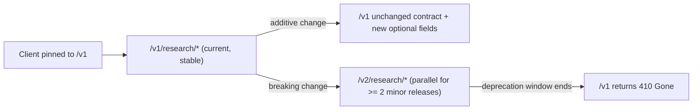

# API Design & Versioning Policy
## Autonomous Investment Research Intelligence Agent (IRA)

---

### Document Control
- **Document Version:** 1.0.0
- **Contract:** [`openapi.yaml`](../openapi.yaml) (OpenAPI 3.1), served live at `/openapi.json`, `/docs`, `/redoc`
- **Schema Source of Truth:** Pydantic v2 models in [`src/models/request.py`](../src/models/request.py) and [`src/models/response.py`](../src/models/response.py)

---

## 1. Contract-First Design

Every public endpoint is declared in `openapi.yaml` before implementation and enforced at runtime by
FastAPI's Pydantic validation: request bodies that do not conform are rejected with `422`, and
responses are serialized through `response_model=ResearchBriefResponse`, so an undocumented field
cannot leak into the wire format.

| Endpoint | Method | Purpose | Auth |
|---|---|---|---|
| `/v1/research/equity` | `POST` | Synthesize a multi-source equity research brief | Cloud Run IAM + OIDC bearer |
| `/v1/research/filings` | `POST` | Extract normalized SEC filing statements | Cloud Run IAM + OIDC bearer |
| `/healthz` | `GET` | Container liveness probe | none (internal probe) |
| `/readyz` | `GET` | Readiness, runtime mode, circuit-breaker state | Cloud Run IAM |
| `/adk/*` | mixed | Mounted Google ADK runtime (`/adk/run_sse`, sessions, dev UI) | Cloud Run IAM + OIDC bearer |

---

## 2. Versioning Scheme

- **URL-prefix major versioning.** The major version lives in the path (`/v1/...`). A major
  version only increments on a breaking change.
- **Semantic versioning of the contract.** `info.version` in `openapi.yaml` and `version=` in
  [`src/api/app.py`](../src/api/app.py) follow `MAJOR.MINOR.PATCH`:
  - `MAJOR` — breaking change (field removed/renamed, type changed, semantics changed).
  - `MINOR` — backward-compatible addition (new optional field, new endpoint, new enum value on
    output).
  - `PATCH` — documentation or bug fix with no schema change.
- **Response schema stability.** Fields are never removed or retyped within a major version. New
  output fields are optional and additive. Clients must ignore unknown fields.
- **Request schema stability.** New request fields are optional with defaults that preserve prior
  behaviour (e.g. `include_macro_context: true`).
- **Enumerations.** New values may be appended to output enumerations (e.g. `source_type`) within a
  major version; clients treat unknown values as opaque.

---

## 3. Backward-Compatibility Rules

| Change | Allowed in `/v1`? | Handling |
|---|---|---|
| Add optional request field | Yes | Default preserves current behaviour |
| Add response field | Yes | Additive, documented in `openapi.yaml` |
| Add endpoint | Yes | New path under `/v1` |
| Tighten validation on an existing field | No | Requires `/v2` |
| Rename / remove / retype a field | No | Requires `/v2` |
| Change error envelope shape | No | Requires `/v2` |

Breaking changes ship as `/v2` alongside `/v1`; `/v1` remains available for at least two minor
releases and is announced in the changelog and the `Deprecation` response header before it returns
`410 Gone`.

---

## 4. Error Contract

All domain errors derive from
[`FinancialAgentException`](../src/core/exceptions.py) and map to stable HTTP statuses:

| `error_code` | HTTP | Trigger |
|---|---|---|
| `SECURITY_VIOLATION` | 400 | Prompt-injection / jailbreak pattern intercepted pre-execution |
| `OUT_OF_DOMAIN_QUERY` | 400 | Request outside equity research scope |
| `FILING_NOT_FOUND` | 404 | No audited filing for ticker / form / fiscal year |
| `REGISTRANT_MISMATCH` | 404 | Ticker resolves to a successor CIK without the requested form |
| `VERIFICATION_FAILED` | 422 | Line-item provenance assertion failed |
| `UPSTREAM_UNAVAILABLE` | 503 | SEC EDGAR unreachable and no verified fixture exists |
| `UPSTREAM_TIMEOUT` | 504 | Required sub-agent exceeded `SUBAGENT_TIMEOUT_SECONDS` |

---

## 5. Change Management

1. Update the Pydantic model and `openapi.yaml` in the same change.
2. Bump `info.version` / `FastAPI(version=...)` per the rules above.
3. Add or update contract tests in [`tests/integration/test_api_routes.py`](../tests/integration/test_api_routes.py).
4. CI (`ci-lint-test.yml`) and the Cloud Build pipeline block merges on failing contract tests.
