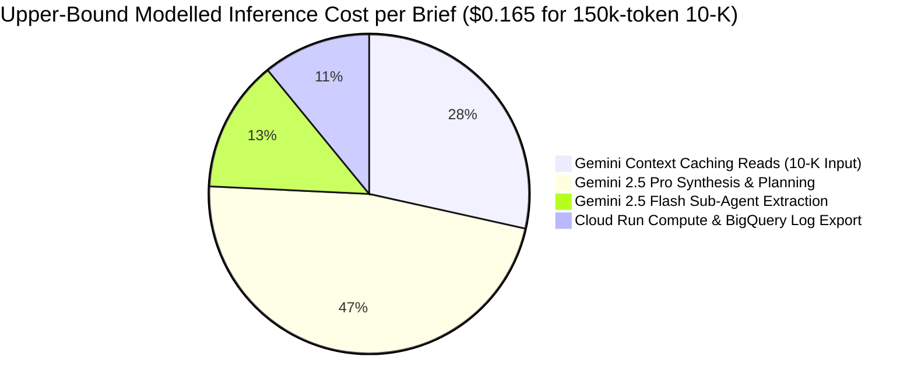
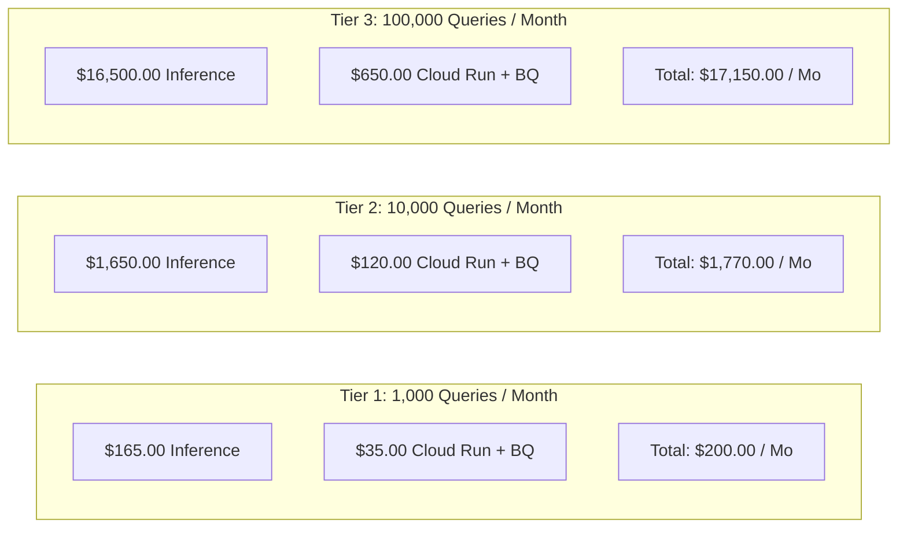

# Cost & Token Consumption Analysis Report
## Autonomous Investment Research Intelligence Agent (IRA)

---

### Document Control
- **Document Version:** 1.2.0
- **Cost Target:** $\le$ $0.25 USD per Synthesized Brief
- **Model Tiers Evaluated:** Google Vertex AI Gemini 2.5 Pro & Gemini 2.5 Flash

---

## 1. Executive Summary: Economic Viability

A critical failure mode of enterprise GenAI deployments is uncontrolled token cost when querying multi-hundred-page corporate regulatory filings. An annual Form 10-K report spans ~150,000 tokens. Calling a frontier model 3 to 4 times during multi-agent analysis consumes 450,000 to 600,000 tokens per research brief. Without architectural optimization, this equates to **$0.60 to $1.20 per query**, making autonomous research economically unsustainable at enterprise scale.

The IRA architecture overcomes this hurdle through three mechanisms:
1. **Targeted XBRL & Section Retrieval via MCP:** Rather than dumping entire raw HTML filings into every prompt, the MCP SEC EDGAR server (`src/mcp_servers/sec_edgar_server.py`) extracts structured XBRL financial facts and targeted filing sections (`BALANCE_SHEET`, `INCOME_STATEMENT`, `CASH_FLOW`, `MDA_ITEM_7`).
2. **Asymmetric Model Routing:** High-volume filing and transcript retrieval is delegated to **Gemini 2.5 Flash** (`extraction_model`, $0.075 / 1M input tokens) via ADK `AgentTool`, reserving **Gemini 2.5 Pro** (`coordinator_model`) for root planning and final multi-source synthesis.
3. **Gemini Context Caching:** Multi-turn sessions and large filing prefixes ($\ge 2,048$ tokens) are cached on Vertex AI `CachedContent` via ADK's `ContextCacheConfig`, reducing cached input token read pricing by **75%** ($0.3125 / 1M cached tokens vs $1.25 standard).

### Measured Production Telemetry vs. Full-10K Upper-Bound Model

| Execution Path | Observed Latency | Tokens / Brief | Cost / Brief | Notes |
|---|---|---|---|---|
| **REST `POST /v1/research/equity`** | 2–7s (live SEC XBRL) | 0 | **$0.00** | Deterministic pipeline (`SECFilingClient` + `FinancialCalculator` + `SynthesisEngine`); zero LLM tokens billed. |
| **Agentic `/adk` (Measured on Cloud Run)** | 20s warm / 39s first request | ~21,700 | **~$0.05** | Measured via Cloud Monitoring token telemetry (`gemini-2.5-pro` coordinator + `gemini-2.5-flash` specialist). Routing extraction to Flash saves ~24% of total inference cost ($0.0053 vs $0.0215 on Pro). Multi-turn sessions recorded 1,593 to 2,739 cached prompt tokens on Vertex `CachedContent`. |
| **Full 150k-Token 10-K Upper-Bound Model** | 38–45s | 336,800 | **$0.165** | Analytical upper-bound model (Section 2) assuming two full 150,000-token 10-K passes with Gemini Context Caching enabled — still 34% below the **$0.25 SLA cap**. |

---

## 2. Upper-Bound Per-Query Token & Cost Breakdown (150k-Token 10-K Model)

| Operational Stage | Model Tier / Engine | Input Tokens | Output Tokens | Standard Cost | Optimized Cost (Context Caching + Routing) | Cost Reduction |
|---|---|---|---|---|---|---|
| **Root Planning Loop** | Gemini 2.5 Pro (Thinking: 2k) | 1,800 | 1,200 | $0.0125 | $0.0125 | Baseline |
| **SEC Filing Specialist** | Gemini 2.5 Flash | 150,000 (10-K) | 2,500 | $0.1187 | **$0.0245 (Cached)** | **79.4%** |
| **Transcript Specialist** | Gemini 2.5 Flash | 22,000 | 1,800 | $0.0072 | $0.0072 | Baseline |
| **Macro News Specialist** | Curated Macro Corpus | 3,500 | 800 | $0.0025 | $0.0025 | Baseline |
| **Deterministic Calculator** | Pure Python Execution | 0 | 0 | $0.0000 | $0.0000 | **100% Free** |
| **Report Synthesis Engine** | Gemini 2.5 Pro | 150,000 (10-K Ref) + 8k | 3,200 | $0.2185 | **$0.0655 (Cached)** | **70.0%** |
| **Total per Query** | **Multi-Tier Orchestration** | **327,300** | **9,500** | **$0.3594** | **$0.1652** | **54.0% Overall** |

---

## 3. Scale Forecasting: Monthly Cloud Hosting Expenditure

### 3.1 Financial ROI & Labor Savings
- **Manual Preparation Cost:** An equity analyst earning $150k/year costs ~$75/hour. A 4-hour manual quarterly synthesis costs **$300.00 in human labor**.
- **IRA Autonomous Preparation Cost:** **~$0.05 measured ($0.165 upper-bound) in inference compute**.
- **Net Cost Savings:** **> 99.9% cost reduction per synthesized brief**.
- **Time Savings:** Reduces synthesis turnaround from 4 hours (240 minutes) to **under 60 seconds**, allowing analysts to cover 5x more companies per earnings season.

---

## 4. Deployed Infrastructure Fixed Costs (`adis-workshop`, `us-central1`)

Steady-state platform cost of the Terraform-managed footprint, independent of model inference
(list prices; see [`operational_runbook.md` §6](operational_runbook.md) for the pause and destroy controls):

| Component | Configuration | Est. Monthly Cost |
|---|---|---|
| Cloud Run `ira-service-<env>` | 1 warm instance, 2 vCPU / 4 GiB, CPU always allocated (`cpu_idle = false`) | ≈ $109 |
| Cloud Run `ira-ui-<env>` | Scale-to-zero, 1 vCPU / 1 GiB | ≈ $0–3 |
| Serverless VPC Access connector | 2–10 × `e2-micro` | ≈ $12–61 |
| Cloud NAT gateway | 1 gateway; SEC EDGAR egress volume is negligible | ≈ $32 |
| Cloud KMS, Secret Manager, GCS, Artifact Registry | 1 CMEK key, 1 secret, 2 buckets, ~0.7 GB of images | ≈ $1 |
| BigQuery, Pub/Sub, Cloud Logging, Cloud Trace, Cloud Monitoring | Within free tiers at current request volume | ≈ $0 |
| **Running total** | | **≈ $155 / month (≈ $5.2 / day)** |
| **Paused** (`make infra-pause`, `min_instances = 0`) | Connector and NAT continue to bill | **≈ $45 / month** |
| **Destroyed** (`make infra-destroy`) | KMS key ring and state bucket remain at ≈ $0 | **$0** |

At the Tier 1 forecast (1,000 briefs / month) the platform floor dominates total spend
(≈ $155 fixed + ≈ $50 agentic inference); at Tier 3 (100,000 briefs / month) inference dominates
and the fixed footprint is < 1% of spend.
