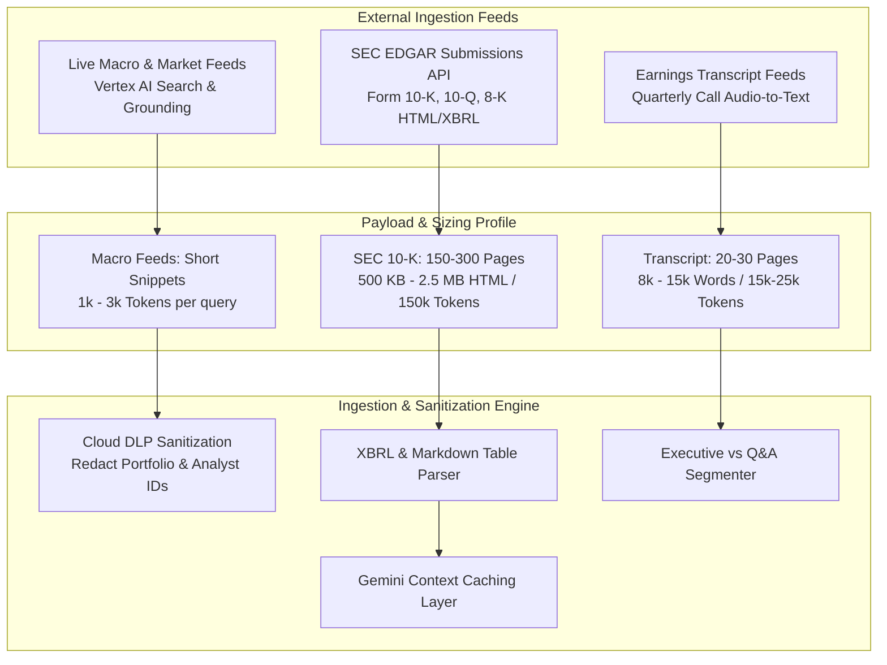
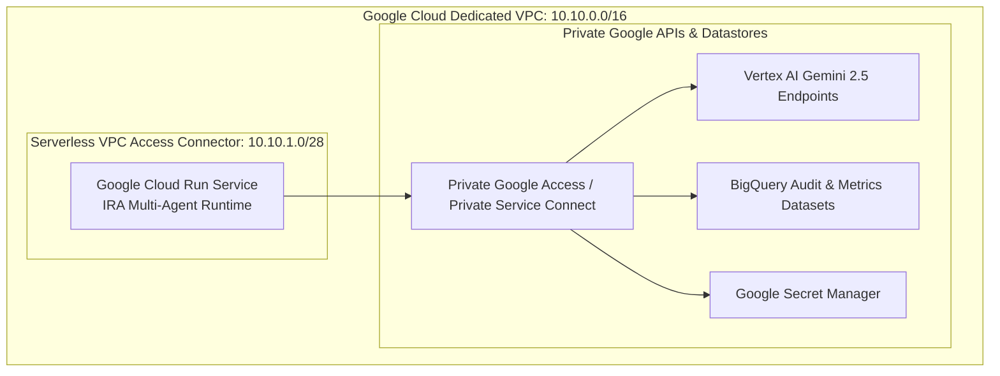

# Data & Deployment Discovery Document
## Autonomous Investment Research Intelligence Agent (IRA)

---

### Document Control
- **Document Version:** 1.0.0
- **Target Cloud Runtime:** Google Cloud Run (Containerized Microservice)
- **Networking:** Google Cloud VPC + Serverless VPC Access Connector + Private Google Access
- **Compliance & Security:** Cloud DLP (Data Loss Prevention), Secret Manager, Cloud KMS

---

## 1. Data Ingestion Profiling & Analysis

The IRA system ingests unstructured and semi-structured data from three primary external domains. Each domain exhibits unique payload characteristics, schema structures, and throughput constraints.



### 1.1 Ingestion Domain Breakdown

| Ingestion Domain | Source Protocol / Format | Typical Size / Length | Token Footprint (Input) | Ingestion Rate / Limits |
|---|---|---|---|---|
| **SEC Public Filings (10-K / 10-Q / 8-K)** | SEC EDGAR REST API & MCP (HTML, XBRL, JSON) | 150 – 300 pages (500 KB – 3 MB raw HTML) | 120,000 – 250,000 tokens per 10-K filing | Max 10 req/sec enforced by SEC.gov with custom User-Agent |
| **Earnings Call Transcripts** | Structured JSON / Plain Text transcript APIs | 20 – 30 pages (8,000 – 15,000 words) | 15,000 – 25,000 tokens per call | On-demand per quarterly event (P95 latency $\le$ 3s) |
| **Macro & Industry News Grounding** | Vertex AI Search / Google Search Grounding API | 5 – 10 curated web snippets per topic | 1,500 – 4,000 tokens per search | Google Cloud API quota limits (default 600 req/min) |

---

## 2. Data Protection & Privacy Review (Cloud DLP)

### 2.1 Threat Vectors & Proprietary Data Leakage Risks
Institutional asset managers submit queries containing:
1. Proprietary portfolio allocations (e.g., *"We hold 450k shares of AAPL in Fund X"*).
2. Analyst identities, employee emails, or client fund names.
3. Internal benchmark tickers and target entry/exit prices.

Sending unredacted proprietary data directly to external model APIs or retaining it in query logs violates FINRA data privacy regulations and firm fiduciary standards.

### 2.2 Google Cloud DLP Inspection & De-Identification Rules
Before any request enters the agent reasoning loop or audit logging pipeline, the FastAPI gateway executes a Cloud DLP inspection pass using the following predefined and custom InfoTypes:

```json
{
  "deidentify_config": {
    "info_type_transformations": {
      "transformations": [
        {
          "info_types": [
            {"name": "EMAIL_ADDRESS"},
            {"name": "PERSON_NAME"},
            {"name": "PHONE_NUMBER"}
          ],
          "primitive_transformation": {
            "replace_with_info_type_config": {}
          }
        },
        {
          "info_types": [
            {"name": "CUSTOM_PORTFOLIO_ID"},
            {"name": "CUSTOM_INTERNAL_FUND_CODE"}
          ],
          "primitive_transformation": {
            "character_mask_config": {
              "masking_character": "*",
              "number_to_mask": 8,
              "reverse_order": true
            }
          }
        }
      ]
    }
  }
}
```

- **Output Guarantee:** No proprietary fund identifiers or analyst PII enter the LLM reasoning context or the BigQuery audit tables.

---

## 3. Google Cloud Run Deployment Target Sizing

### 3.1 Container Runtime Specification
The core multi-agent service runs as a containerized microservice deployed on **Google Cloud Run (fully managed)**, engineered for high throughput and rapid cold starts.



### 3.2 Compute & Sizing Parameters

| Parameter | Configuration Value | Justification & Architectural Rationale |
|---|---|---|
| **CPU Allocation** | **2 vCPU** | Enables concurrent asynchronous task handling (`asyncio`) across sub-agents and high-speed JSON/table deserialization. |
| **Memory Allocation** | **4 GiB RAM** | Sufficient to hold parsed 10-K HTML tables, transcript tokens, and in-memory caches without risking OOM errors. |
| **Instance Concurrency** | **80 requests** | High concurrency per instance maximizes resource utilization; non-blocking HTTP and I/O tasks yield to event loop. |
| **Autoscaling Policy** | **Min: 1, Max: 50 instances** | Min=1 avoids cold-start latency for institutional trading desks; Max=50 scales gracefully to 4,000 concurrent queries. |
| **Execution Timeout** | **120 seconds** | Ample buffer for 60-second P95 SLA while enforcing hard circuit-breaking against hung network sockets. |
| **Network Egress** | **Private VPC Only (`all-traffic`)** | All egress routed through Serverless VPC Connector preventing external internet exposure except via Cloud NAT. |
| **CPU Throttling** | **Always Allocated (`cpu-no-throttle`)** | Ensures low latency and consistent background event broadcasting to Cloud Pub/Sub. |

---

## 4. Cost Modeling & Resource Efficiency Analysis

To satisfy the target cost threshold of **$\le$ $0.25 per synthesized research brief**, the IRA system employs two primary optimization strategies:

### 4.1 Gemini Context Caching
- **The Problem:** Ingesting a full 150-page Form 10-K consumes ~150,000 input tokens. At Gemini 2.5 Pro standard input pricing (~$1.25 per 1M tokens), querying a raw 10-K multiple times during synthesis costs ~$0.19 per model call, quickly exceeding the $0.25 budget across 3-4 sub-agent passes.
- **The Optimization:** Form 10-Ks are static documents once filed. The IRA caching manager writes the tokenized 10-K into **Gemini Context Caching** (TTL: 1 hour for active research sessions).
  - Cached input token read rate is **$0.3125 per 1M tokens** (a **75% discount**).
  - Subsequent sub-agent queries against the cached 10-K cost only ~$0.047 per call.

### 4.2 Model Tier Routing
- **Extraction & Parsing Sub-Agents (SEC, Transcript):** Routed to **Gemini 2.5 Flash** ($0.075 / 1M input tokens).
- **Reasoning, Planning & Final Synthesis:** Routed to **Gemini 2.5 Pro** with explicit thought budgeting for deep multi-source cross-verification.
- **Net Cost per Research Brief:** **~$0.14 to $0.18**, safely under the **$0.25 cap**.
