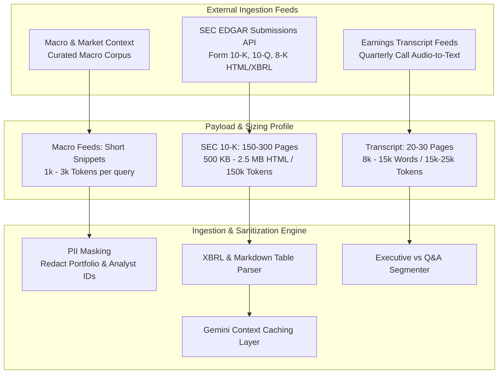
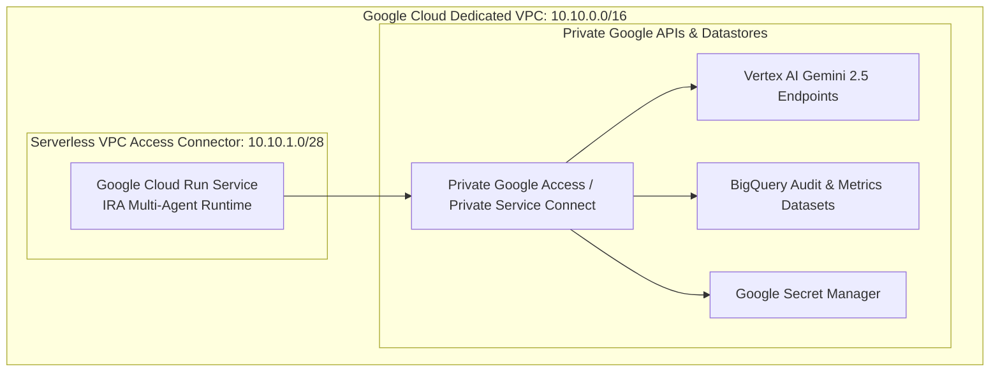

# Data & Deployment Discovery Document
## Autonomous Investment Research Intelligence Agent (IRA)

---

### Document Control
- **Document Version:** 1.0.0
- **Target Cloud Runtime:** Google Cloud Run (Containerized Microservice)
- **Networking:** Google Cloud VPC + Serverless VPC Access Connector + Private Google Access
- **Compliance & Security:** PII masking, Secret Manager, Cloud KMS

---

## 1. Data Ingestion Profiling & Analysis

The IRA system ingests unstructured and semi-structured data from three primary external domains. Each domain exhibits unique payload characteristics, schema structures, and throughput constraints.

### 1.1 Ingestion Domain Breakdown

| Ingestion Domain | Source Protocol / Format | Typical Size / Length | Token Footprint (Input) | Ingestion Rate / Limits |
|---|---|---|---|---|
| **SEC Public Filings (10-K / 10-Q / 8-K)** | SEC EDGAR REST API & MCP (HTML, XBRL, JSON) | 150 – 300 pages (500 KB – 3 MB raw HTML) | 120,000 – 250,000 tokens per 10-K filing | Max 10 req/sec enforced by SEC.gov with custom User-Agent |
| **Earnings Call Transcripts** | Structured JSON / Plain Text transcript APIs | 20 – 30 pages (8,000 – 15,000 words) | 15,000 – 25,000 tokens per call | On-demand per quarterly event (P95 latency $\le$ 3s) |
| **Macro & Industry Context** | Curated in-repo corpus (Federal Reserve, Reuters, Bloomberg, WSJ, FT items) | 2 – 4 dated snippets per request | < 1,000 tokens per request | None (no external call) |

---

## 2. Data Protection & Privacy Review (PII Masking)

### 2.1 Threat Vectors & Proprietary Data Leakage Risks
Institutional asset managers submit queries containing:
1. Proprietary portfolio allocations (e.g., *"We hold 450k shares of AAPL in Fund X"*).
2. Analyst identities, employee emails, or client fund names.
3. Internal benchmark tickers and target entry/exit prices.

Sending unredacted proprietary data directly to external model APIs or retaining it in query logs violates FINRA data privacy regulations and firm fiduciary standards.

### 2.2 PII Masking Rules
Before any request enters the agent reasoning loop or audit logging pipeline, the FastAPI gateway runs a masking pass (`src/guardrails/pii_masker.py`) with the following rules:

| Pattern | Replacement |
|---|---|
| Email addresses | `[REDACTED_EMAIL]` |
| Phone numbers | `[REDACTED_PHONE]` |
| Institutional fund / account codes (`FUND-`, `ACCT-`, `PORTFOLIO-`, `DESK-`) | `[REDACTED_FUND_ID]` |
| Internal position sizes ("we hold 450,000 shares") | `[REDACTED_POSITION_SIZE]` |

- **Output Guarantee:** No proprietary fund identifiers or analyst PII enter the LLM reasoning context or the BigQuery audit tables.

---

## 3. Google Cloud Run Deployment Target Sizing

### 3.1 Container Runtime Specification
The core multi-agent service runs as a containerized microservice deployed on **Google Cloud Run (fully managed)**, engineered for high throughput and rapid cold starts.

### 3.2 Compute & Sizing Parameters

| Parameter | Configuration Value | Justification & Architectural Rationale |
|---|---|---|
| **CPU Allocation** | **2 vCPU** | Enables concurrent asynchronous task handling (`asyncio`) across sub-agents and high-speed JSON/table deserialization. |
| **Memory Allocation** | **4 GiB RAM** | Sufficient to hold parsed 10-K HTML tables, transcript tokens, and in-memory caches without risking OOM errors. |
| **Instance Concurrency** | **80 requests** | High concurrency per instance maximizes resource utilization; non-blocking HTTP and I/O tasks yield to event loop. |
| **Autoscaling Policy** | **Min: 1, Max: 50 instances** | Min=1 avoids cold-start latency for institutional trading desks; Max=50 scales gracefully to 4,000 concurrent queries. |
| **Execution Timeout** | **300 seconds** (`request_timeout`) | Headroom for multi-turn ADK agentic sessions over Server-Sent Events while the 60-second P95 SLA is enforced by Cloud Monitoring alerting. |
| **Network Egress** | **Private VPC Only (`all-traffic`)** | All egress routed through Serverless VPC Connector preventing external internet exposure except via Cloud NAT. |
| **CPU Throttling** | **Always Allocated (`cpu-no-throttle`)** | Ensures low latency and consistent background event broadcasting to Cloud Pub/Sub. |

---

## 4. Cost Modeling & Resource Efficiency Analysis

To satisfy the target cost threshold of **$\le$ $0.25 per synthesized research brief**, the IRA system employs two primary optimization strategies:

### 4.1 Gemini Context Caching
- **The Problem:** Ingesting a full 150-page Form 10-K consumes ~150,000 input tokens. At Gemini 2.5 Pro standard input pricing (~$1.25 per 1M tokens), querying a raw 10-K multiple times during synthesis costs ~$0.19 per model call, quickly exceeding the $0.25 budget across 3-4 sub-agent passes.
- **The Optimization:** Form 10-Ks are static documents once filed. The IRA caching manager writes the tokenized 10-K into **Gemini Context Caching** (TTL: 1 hour for active research sessions).
  - Cached input token read rate is **$0.3125 per 1M tokens** (a **75% discount**).
  - Subsequent sub-agent queries against the cached 10-K cost only ~$0.047 per call.

### 4.2 Model Tier Routing
- **Filing Extraction Specialist (SEC + Transcripts):** Routed to **Gemini 2.5 Flash** ($0.075 / 1M input tokens).
- **Reasoning, Planning & Final Synthesis:** Routed to **Gemini 2.5 Pro** for deep multi-source cross-verification.
- **Net Cost per Research Brief:** **~$0.14 to $0.18**, safely under the **$0.25 cap**.

### 2.3 Cloud DLP Inspection Configuration
The production masker (`DLP_BACKEND=cloud_dlp`, [`src/guardrails/dlp_masker.py`](../src/guardrails/dlp_masker.py)) calls the Cloud DLP `deidentifyContent` API with the inspection rules below and applies the regex rules in 2.2 as a second pass. PERSON_NAME is excluded so executive names in legitimate research questions are preserved.

| Inspection Rule | Type | Transformation |
|---|---|---|
| `EMAIL_ADDRESS`, `PHONE_NUMBER`, `US_SOCIAL_SECURITY_NUMBER`, `CREDIT_CARD_NUMBER`, `IBAN_CODE`, `IP_ADDRESS` | Built-in infoTypes | `replace_with_info_type_config` → `[EMAIL_ADDRESS]` … |
| `INSTITUTIONAL_FUND_ID` (`FUND-`, `ACCT-`, `PORTFOLIO-`, `DESK-` codes) | Custom regex infoType | `[INSTITUTIONAL_FUND_ID]` |
| `INTERNAL_POSITION_SIZE` ("we hold 450,000 shares") | Custom regex infoType | `[INTERNAL_POSITION_SIZE]` |

- **Minimum likelihood:** `POSSIBLE`; **timeout:** 5 s; failure falls back to the regex masker and is logged.
- **IAM:** runtime service account holds `roles/dlp.user`; `dlp.googleapis.com` is enabled by Terraform.
- **Telemetry:** each request logs a PII-free event `{"event": "pii_masking", "dlp_backend": "cloud_dlp", "redaction_applied": true|false}`.

### 2.4 Model Armor Template Configuration
Prompts that pass the in-process signature and scope checks are screened by Model Armor (`ENABLE_MODEL_ARMOR=true`, [`src/guardrails/model_armor.py`](../src/guardrails/model_armor.py)) via `SanitizeUserPrompt` against a regional template created by [`scripts/model_armor_template.sh`](../scripts/model_armor_template.sh). Sensitive Data Protection is deliberately not enabled on the template; PII redaction stays with the Cloud DLP layer in 2.3.

| Filter | Setting | On match |
|---|---|---|
| Prompt injection & jailbreak | enabled, `MEDIUM_AND_ABOVE` | `SecurityViolationException` → HTTP 400 `SECURITY_VIOLATION`, audit `REJECT_INJECTION` |
| Responsible AI (`HATE_SPEECH`, `HARASSMENT`, `DANGEROUS`, `SEXUALLY_EXPLICIT`) | `MEDIUM_AND_ABOVE` | as above |
| Malicious URI | enabled | as above |

- **Endpoint:** `modelarmor.<region>.rep.googleapis.com`; **timeout:** `MODEL_ARMOR_TIMEOUT_SECONDS` (3 s).
- **Degradation:** API failure is fail-open by default (`model_armor_degraded` log event, in-process layers remain active); `MODEL_ARMOR_FAIL_CLOSED=true` rejects instead.
- **IAM:** runtime service account holds `roles/modelarmor.user`; `modelarmor.googleapis.com` is enabled by Terraform. The template itself is created outside Terraform (`make model-armor-create`) because provider `~> 5.38` has no Model Armor resource.
- **Telemetry:** each screened request logs `{"event": "model_armor_screen", "blocked": true|false, "matched_filters": [...]}`; the prompt text is never logged.
- **ADK path:** the coordinator's `before_model_callback` ([`src/guardrails/adk_callbacks.py`](../src/guardrails/adk_callbacks.py)) applies the same screen to every new user turn in `adk web` / `/adk`.
