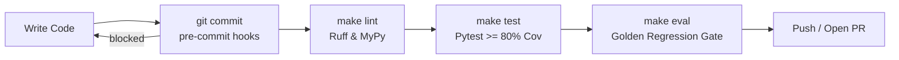

# Developer Onboarding & Setup Guide
## Autonomous Investment Research Intelligence Agent (IRA)

---

### Document Control
- **Document Version:** 1.0.0
- **Target Audience:** Quantitative Software Engineers, AI Engineers, Financial Engineers

---

## 1. Prerequisites & Toolchains

Before contributing to the IRA project, verify your workstation has the following installed:
- **Python:** Version 3.11 or 3.12 (`python3 --version`)
- **Git:** Version 2.40+ (`git --version`)
- **Docker:** Docker Desktop or Colima for container packaging (`docker --version`)
- **Google Cloud SDK:** `gcloud` CLI authenticated with GCP permissions (`gcloud auth login`)
- **Make:** Standard build utility (`make --version`)

---

## 2. Local Sandbox Setup

### Step 2.1: Clone the Repository
```bash
git clone https://github.com/Ignotus-21/Finance-Agent---Investment-Research-Agent.git
cd Finance-Agent---Investment-Research-Agent
```

### Step 2.2: Create and Activate Virtual Environment
```bash
python3 -m venv .venv
source .venv/bin/activate
```

### Step 2.3: Install Dependencies (Application & Development)
```bash
# Install package in editable mode with development tooling
pip install --upgrade pip
pip install -e .[dev]

# Activate the Git pre-commit hooks (see section 3.0)
pre-commit install
```

> Or simply run `make install`, which performs both steps.

### Step 2.4: Configure Environment Variables
Copy the template configuration file:
```bash
cp .env.example .env
```
Ensure `.env` contains:
```ini
ENVIRONMENT=development
DEBUG=True
GCP_PROJECT_ID=ira-capstone-finance-prod
GCP_REGION=us-central1
COORDINATOR_MODEL=gemini-2.5-pro
EXTRACTION_MODEL=gemini-2.5-flash
THINKING_BUDGET=2048
SEC_EDGAR_USER_AGENT="SampleInstitutionalResearch AdminContact@samplecompany.com"
SEC_RATE_LIMIT_PER_SEC=8.0
CONTEXT_CACHE_TTL_MINUTES=60
MAX_BRIEF_COST_USD=0.25
```

---

## 3. Developer Quality Tooling & Commands

All development workflows are standardized via the project `Makefile`:



### 3.0 Pre-Commit Hooks (First Line of Defence)

Every commit is gated locally by [`.pre-commit-config.yaml`](file:///.pre-commit-config.yaml), so
defects are caught in seconds on your machine rather than minutes later in Cloud Build.

```bash
make hooks        # one-time activation (also run by `make install`)
make hooks-run    # run every hook against the whole repo - CI parity check
```

| Hook | What it blocks |
|---|---|
| `ruff` (autofix) | Lint violations and unsorted imports in `src/`, `tests/`, `scripts/`, `eval/` |
| `mypy` | Type errors in `src/` |
| `detect-secrets` | Credentials reaching the object store; reviewed findings live in `.secrets.baseline` |
| `detect-private-key` | Committed private keys |
| `check-yaml` / `check-toml` / `check-json` | Malformed `cloudbuild.yaml`, workflows, or configs |
| `debug-statements` | A stray `breakpoint()` shipping to a Cloud Run revision |
| `end-of-file-fixer` / `trailing-whitespace` | Whitespace noise in future diffs |
| `check-added-large-files` | Accidental commits over 512 KB |

Two deliberate omissions:

- **No auto-formatter.** `ruff format` / `black` would rewrite 37 of the 61 Python files on the
  first run, burying real changes in cosmetic churn. Ruff's linter already enforces import
  ordering and the pycodestyle rules that matter. Adopting a formatter should be one isolated
  `style:` commit first, then a hook.
- **No test suite in the hook.** `make test` and `make eval` are too slow for a commit hook and
  would push everyone toward `--no-verify`. Both run on every push in
  [`.github/workflows/`](file:///.github/workflows/).

To bypass in a genuine emergency: `git commit --no-verify`. CI will still enforce the same checks.

### 3.1 Automated Testing & Code Coverage
Run the full unit, integration, and chaos test suites:
```bash
make test
# Direct invocation with coverage threshold assertion:
pytest --cov=src --cov-fail-under=80 --cov-report=term-missing -v
```

### 3.2 Evaluation Benchmark Regression Gate
Execute the automated evaluation suite against the 52 scenarios in the Golden Dataset:
```bash
make eval
# Direct invocation:
python -m eval.regression_gate
```

### 3.3 Linting & Static Type Checking
Assert code formatting and type safety:
```bash
make lint
# Direct invocation:
ruff check src/ tests/
mypy src/ --ignore-missing-imports
```

### 3.4 Launch Local Development Server
Start the FastAPI server locally on port 8080 with live reload:
```bash
make run
# Server will be accessible at:
# API Docs: http://localhost:8080/docs
# ReDoc: http://localhost:8080/redoc
```

### 3.5 Launch the Streamlit Test Console
```bash
make install-ui
make ui           # http://localhost:8502
```

Streamlit is an opt-in extra (`.[ui]`) and is excluded from both the Docker and
the Cloud Build context. A developer tool has no business in the runtime image.

Against localhost the console sends an unverified bearer credential, because
`AUTH_ALLOWED_AUDIENCES` is empty outside production and the service records the
caller as `unverified-*`. Against a deployed revision it needs a service account
to impersonate: a **user account cannot mint an ID token for a specific
audience**, which is why the sidebar asks for one rather than calling
`gcloud auth print-identity-token` directly. Terraform creates
`ira-caller-<env>-sa` for precisely this, and `terraform output
caller_service_account` prints it.

---

## 4. Git Multi-Branch Workflow & Contribution Standards

The IRA repository enforces **Trunk-Based / GitFlow development** with strict Conventional Commits:

1. **Branch Naming:**
   - Feature branches: `feature/<phase>-<description>` (e.g. `feature/phase3-sec-edgar-mcp`)
   - Bug fixes: `fix/<issue-description>`
   - Documentation: `docs/<description>`

2. **Conventional Commit Format:**
   ```
   <type>(<scope>): <subject>

   [optional body]
   ```
   *Examples:*
   - `feat(sec-agent): implement XBRL line-item extraction with citation provenance`
   - `fix(guardrail): refine stock speculation regex to capture comma-separated shares`
   - `test(chaos): add circuit breaker 5-failure trip test`
   - `docs(adr): document ADR-003 context caching decision`

3. **Pull Request Quality Gates:**
   Every PR must satisfy:
   - Zero linter or type-check warnings (`ruff`, `mypy`).
   - $\ge 80\%$ test coverage on new code.
   - Golden Dataset thresholds for Relevance ($\ge 0.90$), Citation Precision (= 1.0) and Guardrail Rate (= 1.0) satisfied.
   - Faithfulness reports **1.0000 at 51.8% figure coverage** and blocks the build again (the DEV-15 waiver has been removed). Expect `SUCCESS`.
   - Coverage is enforced by a floor as well as the score, so you cannot make the number look better by asserting less ground truth.
   - Completed checklist against the 32 CPSE-to-FDE competencies in `.github/pull_request_template.md`.
