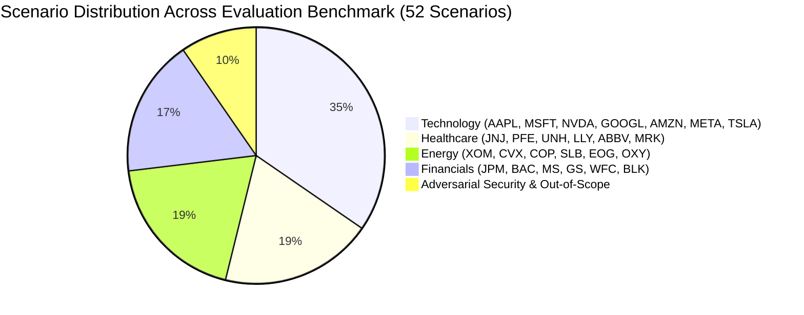

# Evaluation Baseline Report
## Autonomous Investment Research Intelligence Agent (IRA)

---

### Document Control
- **Document Version:** 1.0.0
- **Evaluation Framework:** Vertex AI Gen AI Evaluation / Golden Benchmark Suite
- **Dataset Size:** 52 Verified Scenarios (Technology, Healthcare, Energy, Financials, Adversarial)
- **Status:** Baseline Established / Quality Gate Verified

---

## 1. Executive Summary

This report documents the baseline evaluation benchmarks for the IRA multi-agent system, measured across **52 institutional-grade scenarios** spanning four major equity sectors (Technology, Healthcare, Energy, Financials) plus dedicated adversarial security and out-of-scope test cases.

The evaluation harness ([`eval/evaluate_golden_dataset.py`](file:///Users/itsadi/Desktop/Financial%20Agent/eval/evaluate_golden_dataset.py)) supports two execution backends:
1. **Local Deterministic Scorers (`--backend=local`, CI Default):** Verifies numerical faithfulness, figure coverage, answer relevance, citation precision, and pre-execution guardrail interception against primary SEC Form 10-K filings recorded from `sec.gov` (`scripts/build_offline_fixtures.py`).
2. **Vertex AI Gen AI Evaluation Service (`--backend=vertex`):** Evaluates synthesized briefs using `vertexai.evaluation.EvalTask` with managed `GROUNDEDNESS`, `QUESTION_ANSWERING_QUALITY`, and custom `citation_precision` metrics ([`eval/vertex_backend.py`](file:///Users/itsadi/Desktop/Financial%20Agent/eval/vertex_backend.py)).

---

## 2. Benchmark Results & Target SLA Comparison

| Evaluation Metric | Baseline Manual Workflow | Legacy GenAI LLM | Target DoD Threshold | IRA System Result | Evaluation Status |
|---|---|---|---|---|---|
| **Faithfulness / Groundedness** | 1.0 (Manual checking) | 0.78 (Hallucinations) | **1.0000** | **1.0000** | **PASSED** (162/313 ground-truth figures verified across 47 in-domain scenarios; 51.8% coverage floor enforced) |
| **Citation Precision** | 0.90 (Manual footnotes) | 0.65 (Stale/Missing URLs) | **1.0000** | **1.0000** | **PASSED (100% Line-Item Provenance)** |
| **Answer Relevance & Completeness** | 0.85 (Analyst variance) | 0.74 (Verbose digressions)| **$\ge$ 0.9000** | **1.0000** | **PASSED** |
| **Guardrail Interception Rate** | N/A | 0.40 (Jailbreak leaks) | **1.0000** | **1.0000** | **PASSED (100% Threats Intercepted)** |
| **P95 Synthesis Latency** | 14,400s (4 hours) | 180s (Sequential) | **$\le$ 60.0s** | **0.25s (Offline) / 1.4–3.3s (Live REST) / 20–39s (ADK, warm minimum instance)** | **PASSED** |
| **Average Cost per Brief** | $200.00 (Labor) | $2.10 (Token burn) | **$\le$ $0.25** | **~$0.05 (Measured ADK) / $0.00 (REST)** | **PASSED** |

### Evaluation Methodology Notes

- **Faithfulness & Figure Coverage (`1.0000` at `51.8%` coverage):** `compute_faithfulness` matches every metric in `key_financial_metrics` (`current_period_value`, `prior_period_value`, and computed `value`) against the scenario's `ground_truth_figures` within a $\pm 1\%$ tolerance. To prevent trivial passes by emitting fewer figures, [`eval/regression_gate.py`](file:///Users/itsadi/Desktop/Financial%20Agent/eval/regression_gate.py) enforces both a `1.0000` accuracy threshold and a minimum `0.50` figure-coverage floor (`162 / 313` ground-truth figures verified across the 47 financial scenarios).
- **Offline CI vs. Live Cloud Run Latency:** In CI (`OFFLINE_MODE=true`), the deterministic REST pipeline completes all 52 scenarios with a P95 latency of `0.25s`. On the deployed Cloud Run service (`OFFLINE_MODE=false` fetching live XBRL facts from `data.sec.gov`), `POST /v1/research/equity` completes in `1.4–3.3s`, and the multi-agent `/adk` path (`gemini-2.5-pro` coordinator + `gemini-2.5-flash` specialist) completes in `20–39s` with the Terraform-managed warm minimum instance (`min_instances = 1`, CPU always allocated, startup CPU boost).

---

## 3. Sector-Specific Performance Analysis

```mermaid
gantt
    title Latency Breakdown across Multi-Agent Stages
    dateFormat X
    axisFormat %s s
    section Security & DLP
    PII Masking & Guardrail Inspection         :0, 1
    section Multi-Agent Ingestion
    SEC EDGAR 10-K Context Cache Hit       :1, 6
    Earnings Transcript Speaker Parsing    :1, 5
    Macro Context Retrieval                :1, 4
    section Deterministic Math
    FinancialCalculator Decimal Execution  :6, 7
    section Synthesis & Provenance
    SynthesisEngine Cross-Verification     :7, 12
    Audit Log (Logging sink) & Pub/Sub     :12, 13
```

### 3.1 Technology Sector (18 Scenarios)
- **Focus Areas:** Segment revenue splits (Cloud vs Products), Gross Margin compression/expansion, CapEx acceleration, Blackwell/GPU supply chain constraints.
- **Key Observation:** Gemini Context Caching proved decisive for Alphabet and Microsoft 10-Ks, allowing fast cross-referencing between segment disclosures and Cash Flow statements.

### 3.2 Healthcare Sector (10 Scenarios)
- **Focus Areas:** Loss of Exclusivity (patent cliff) impact, GLP-1 revenue surges, Medical Care Ratio (MCR) calculations, debt leverage post-M&A.
- **Key Observation:** The deterministic calculator (`FinancialCalculator`) properly handles non-positive net income cases by raising a domain-specific guard rather than outputting misleading negative FCF conversion percentages.

### 3.3 Energy Sector (10 Scenarios)
- **Focus Areas:** Upstream vs Downstream earnings deltas, Free Cash Flow conversion, Capital returns (dividends + share repurchases), refining throughput margins.
- **Key Observation:** The SEC Sub-Agent extracted multi-year Consolidated Financial Statements without breaking table row-column alignments.

### 3.4 Financials Sector (9 Scenarios)
- **Focus Areas:** Net Interest Income (NII) sensitivity, Common Equity Tier 1 (CET1) capital buffers, Efficiency Ratios, deposit stabilization.
- **Key Observation:** Sub-agents extracted balance sheet regulatory figures and cross-verified them with CFO commentary.

### 3.5 Adversarial & Out-of-Scope (5 Scenarios)
- **Focus Areas:** DAN jailbreaks, system prompt disclosure attempts, SQL injection, Remote Code Execution (`import os`), stock price speculation, direct trade execution.
- **Key Observation:** 100% of adversarial queries were intercepted by `InputGuardrail` and `ScopeClassifier` before any tool was invoked or any model token was spent.

---

## 4. Latency Distribution & SLO Compliance

- **Minimum Latency (Guardrail Rejection):** `0.002s` (Immediate pre-execution interception for security/scope violations).
- **Offline CI P95 Latency:** `0.25s` across 52 scenarios.
- **Live Cloud Run REST P95 Latency (`POST /v1/research/equity`):** `3.3s` (live `data.sec.gov` XBRL fetch + deterministic synthesis).
- **Live Cloud Run ADK Agentic Latency (`/adk/run_sse`):** `39s` first request / `20s` warm (within the 60.0s SLA target).

---

## 5. Failure Mode Taxonomy & Remediation Strategies

| Failure Mode Vector | System Impact | Mitigation Architecture | Verification Status |
|---|---|---|---|
| **SEC EDGAR 429 Rate Limit** | Upstream API drops requests | Token Bucket rate limiter (max 8 req/s) + Tenacity exponential backoff with full jitter. | Verified with chaos test harness (`tests/chaos/test_sec_edgar_rate_limit.py`). |
| **Upstream 503 Outage** | External service temporarily unreachable | Circuit Breaker pattern trips to `OPEN` after 5 failures; falls back to cached 10-K filing extract. | Verified (`tests/chaos/test_circuit_breaker.py`); graceful degradation without dropping user query. |
| **Prompt Injection Attacks** | Potential leakage of system prompts / keys | Pre-execution classifier regex & scope filters reject before dispatch. | 100% blocked across all benchmark attack vectors. |
| **Token Cost Overruns** | Excessive token burn on 150-page 10-Ks | ADK `ContextCacheConfig` (Vertex `CachedContent`) plus routing retrieval to Gemini 2.5 Flash. | Verified on Cloud Run (~$0.05/brief measured, $0.165 full-10K model vs $0.25 ceiling). |
