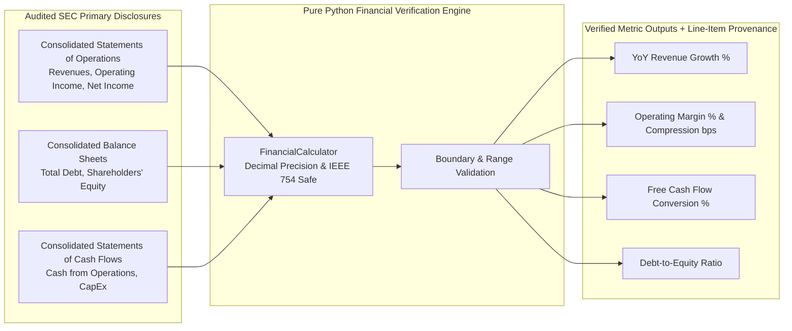

# Financial Domain KPI Specification
## Autonomous Investment Research Intelligence Agent (IRA)

---

### Document Control
- **Document Version:** 1.0.0
- **Domain:** Institutional Equity Research / Corporate Financial Analysis
- **Standard Alignment:** US-GAAP, IFRS, XBRL US Taxonomy, FINRA Rule 2241 (Research Analysts)
- **Engine Implementation:** Pure Python Deterministic Execution (`FinancialCalculator`)

---

## 1. Objective & Architectural Guarantees

In institutional equity research, general-purpose LLMs are strictly prohibited from performing autonomous mental arithmetic on financial figures. Mathematical operations must be executed deterministically in code to eliminate floating-point inconsistencies, hallucinated rounding, and sign errors.

This specification formalizes the exact mathematical formulas, source line items from SEC Form 10-K/10-Q filings, validation rules, and error handling thresholds for all core financial KPIs calculated by the IRA system.



---

## 2. Core Financial KPI Mathematical Specifications

### 2.1 Year-over-Year (YoY) Revenue Growth Rate

#### Formula:
$$\text{YoY Revenue Growth (\%)} = \left( \frac{\text{Total Net Sales}_{t} - \text{Total Net Sales}_{t-1}}{\text{Total Net Sales}_{t-1}} \right) \times 100$$

#### SEC Primary Line-Item Sources:
- **Statement:** Consolidated Statements of Operations (Income Statement)
- **XBRL Tags:** `us-gaap:RevenueFromContractWithCustomerExcludingAssessedTax` OR `us-gaap:Revenues` OR `us-gaap:SalesRevenueNet`
- **Periodicity:** Annual ($FY_t$ vs $FY_{t-1}$) or Quarterly ($Q_t$ vs $Q_{t-4}$)

#### Validation & Constraints:
- $\text{Total Net Sales}_{t-1}$ must be strictly $> 0$.
- If prior period revenue is missing or $\le 0$, calculation returns `None` with warning flag `INVALID_PRIOR_REVENUE_DENOMINATOR`.
- Precision: 2 decimal places (e.g., `+12.45%`).

---

### 2.2 Operating Margin Current & Compression / Expansion

#### Formula:
$$\text{Operating Margin Current (\%)} = \left( \frac{\text{Operating Income (EBIT)}_{t}}{\text{Total Net Sales}_{t}} \right) \times 100$$

$$\text{Operating Margin Compression (bps)} = \left( \text{Operating Margin}_{t-1} - \text{Operating Margin}_{t} \right) \times 100$$

*Note: 1% margin change = 100 basis points (bps). A positive compression figure represents margin deterioration; negative indicates margin expansion.*

#### SEC Primary Line-Item Sources:
- **Statement:** Consolidated Statements of Operations
- **XBRL Tags:**
  - Operating Income: `us-gaap:OperatingIncomeLoss`
  - Total Net Sales: `us-gaap:Revenues`
- **Periodicity:** Fiscal Year or Trailing Twelve Months (TTM)

#### Validation & Constraints:
- Total Net Sales must be $> 0$.
- Operating Income may be negative (indicating operating loss). Operating Margin can range between $[-100.0\%, +100.0\%]$.
- Compression calculation requires valid operating margin for both $t$ and $t-1$.
- Precision: Margin percentage to 2 decimal places (`28.45%`); Compression to 1 decimal place (`120.5 bps`).

---

### 2.3 Free Cash Flow (FCF) Conversion Ratio

#### Formula:
$$\text{Free Cash Flow (FCF)} = \text{Cash Generated by Operating Activities} - \text{Capital Expenditures (CapEx)}$$

$$\text{FCF Conversion Ratio (\%)} = \left( \frac{\text{Free Cash Flow}}{\text{Net Income}} \right) \times 100$$

#### SEC Primary Line-Item Sources:
- **Statement:** Consolidated Statements of Cash Flows & Consolidated Statements of Operations
- **XBRL Tags:**
  - Cash from Operations: `us-gaap:NetCashProvidedByUsedInOperatingActivities`
  - CapEx: `us-gaap:PaymentsToAcquirePropertyPlantAndEquipment` OR `us-gaap:PaymentsToAcquireProductiveAssets`
  - Net Income: `us-gaap:NetIncomeLoss`
- **Periodicity:** Fiscal Year

#### Validation & Constraints:
- CapEx in SEC filings is typically reported as an outflow (positive cash reduction). The calculator enforces absolute value subtraction: $\text{FCF} = \text{Operating Cash} - |\text{CapEx}|$.
- If $\text{Net Income} \le 0$ (net loss) or $|\text{Net Income}| < \$100,000$, FCF Conversion is economically non-meaningful. The engine sets `fcf_conversion_pct = None` with annotation `NET_INCOME_NON_POSITIVE`.
- Precision: 2 decimal places (`108.32%`).

---

### 2.4 Total Debt-to-Equity (D/E) Leverage Ratio

#### Formula:
$$\text{Total Debt} = \text{Short-Term Debt \& Current Portion of Long-Term Debt} + \text{Long-Term Debt}$$

$$\text{Debt-to-Equity Ratio} = \frac{\text{Total Debt}}{\text{Total Shareholders' Equity}}$$

#### SEC Primary Line-Item Sources:
- **Statement:** Consolidated Balance Sheets
- **XBRL Tags:**
  - Short-Term Debt: `us-gaap:DebtCurrent` OR `us-gaap:ShortTermBorrowings`
  - Long-Term Debt: `us-gaap:LongTermDebtNoncurrent`
  - Total Shareholders' Equity: `us-gaap:StockholdersEquity`
- **Periodicity:** Most recent fiscal quarter or fiscal year end date.

#### Validation & Constraints:
- If Shareholders' Equity $\le 0$ (negative net worth due to accumulated deficits or massive share buybacks, e.g., Boeing, Starbucks), ratio is marked as `NEGATIVE_EQUITY_DEFICIT` and reported with an explanatory note rather than a misleading negative ratio.
- Total Debt $\ge 0$. If no short/long-term debt items appear, Total Debt evaluates to $0.0$.
- Precision: 3 decimal places (e.g., `0.842x`).

---

## 3. Precision, Rounding & Unit Rules

| Metric | Internal Precision | Display Format | Unit | Boundary Check |
|---|---|---|---|---|
| **YoY Revenue Growth** | 4 decimal places | `+XX.XX%` | Percentage | $[-100.0\%, +10,000.0\%]$ |
| **Operating Margin** | 4 decimal places | `XX.XX%` | Percentage | $[-500.0\%, +100.0\%]$ |
| **Margin Compression** | 2 decimal places | `XXX.X bps` | Basis Points | $[-5,000.0, +5,000.0]$ |
| **Free Cash Flow** | Exact Currency ($) | `$XXX.XX M/B` | Currency (USD) | N/A |
| **FCF Conversion** | 4 decimal places | `XXX.XX%` | Percentage | Null if Net Income $\le 0$ |
| **Debt-to-Equity** | 4 decimal places | `X.XXXx` | Ratio Multiple | $\ge 0.0$; Null if Equity $\le 0$ |

All intermediate rounding uses **Round Half Up** (`decimal.ROUND_HALF_UP`) to match institutional accounting practices and eliminate IEEE 754 binary floating-point representation drift.

---

## 4. Evidentiary Provenance Data Structure

Every calculated metric produced by the system is linked to its underlying primary source disclosures via the following typed schema:

```json
{
  "metric_name": "yoy_revenue_growth_pct",
  "calculated_value": 15.24,
  "unit": "percentage",
  "formula_applied": "((revenue_current - revenue_prior) / revenue_prior) * 100",
  "underlying_inputs": [
    {
      "variable_name": "revenue_current",
      "reported_value": 394328000000.00,
      "filing_type": "10-K",
      "fiscal_year": 2024,
      "fiscal_period": "FY",
      "accession_number": "0000320193-24-000106",
      "statement_name": "Consolidated Statements of Operations",
      "line_item_name": "Total Net Sales",
      "xbrl_tag": "us-gaap:RevenueFromContractWithCustomerExcludingAssessedTax"
    },
    {
      "variable_name": "revenue_prior",
      "reported_value": 342200000000.00,
      "filing_type": "10-K",
      "fiscal_year": 2023,
      "fiscal_period": "FY",
      "accession_number": "0000320193-23-000106",
      "statement_name": "Consolidated Statements of Operations",
      "line_item_name": "Total Net Sales",
      "xbrl_tag": "us-gaap:RevenueFromContractWithCustomerExcludingAssessedTax"
    }
  ],
  "verification_timestamp": "2026-09-14T12:00:00Z",
  "provenance_verified": true
}
```
