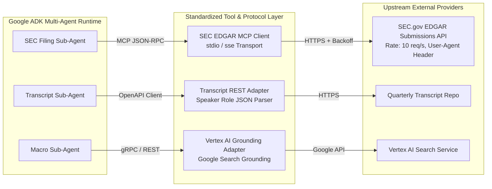
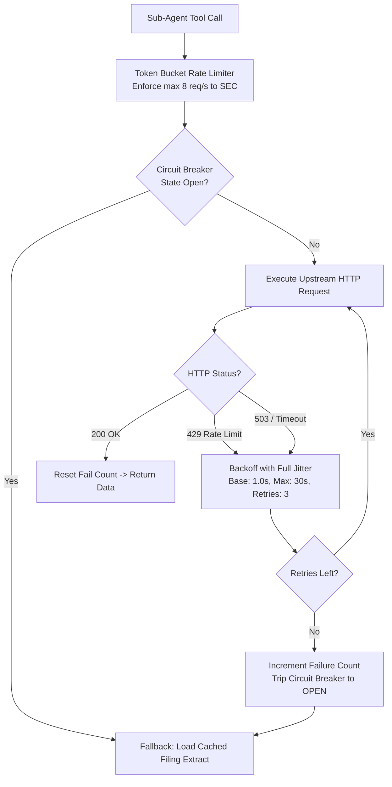

# Grounding & API Discovery Document
## Autonomous Investment Research Intelligence Agent (IRA)

---

### Document Control
- **Document Version:** 1.0.0
- **Protocols Covered:** Model Context Protocol (MCP), OpenAPI 3.1, Vertex AI Search Grounding, SEC EDGAR Submissions API
- **Resilience Engineering:** Tenacity Exponential Backoff, Jitter, Circuit Breaker Pattern

---

## 1. External Data Sources & Tool Connectivity Architecture

To synthesize institutional research briefs, the IRA system connects to three heterogeneous external data interfaces. To avoid tight coupling to proprietary vendor SDKs, all tools adhere to the **Model Context Protocol (MCP)** and standardized REST contracts.



---

## 2. Upstream Protocol Evaluation & Specifications

### 2.1 SEC EDGAR Submissions API & Model Context Protocol (MCP)

#### Protocol & Transport:
- **Standard:** Model Context Protocol (MCP) over `stdio` (local subprocess) or `SSE` (Server-Sent Events).
- **Upstream Host:** `https://data.sec.gov/` and `https://www.sec.gov/edgar/`
- **Authentication:** Public API; no API key required, but **mandatory compliance header** is enforced.

#### SEC Rate Limiting & User-Agent Compliance Rules:
- **SEC Regulation:** The SEC limits all automated web requests to a maximum of **10 requests per second** per IP address. Exceeding this rate results in immediate **HTTP 429 Too Many Requests** IP bans.
- **Mandatory User-Agent Format:**
  $$\text{User-Agent: } \text{CompanyName } \text{AdminContact@domain.com}$$
  Requests lacking a compliant User-Agent are dropped with HTTP 403 Forbidden.
- **MCP Tool Interface Contract:**
  ```json
  {
    "name": "fetch_sec_filing_section",
    "description": "Fetch parsed markdown tables and XBRL line-item metadata for an SEC filing section.",
    "parameters": {
      "type": "object",
      "properties": {
        "ticker": {"type": "string", "description": "Stock ticker symbol (e.g. AAPL)"},
        "form": {"type": "string", "enum": ["10-K", "10-Q", "8-K"], "description": "SEC filing form type"},
        "fiscal_year": {"type": "integer", "description": "Fiscal year (e.g. 2024)"},
        "section": {"type": "string", "enum": ["BALANCE_SHEET", "INCOME_STATEMENT", "CASH_FLOW", "MDA_ITEM_7"], "description": "Filing section to extract"}
      },
      "required": ["ticker", "form", "fiscal_year", "section"]
    }
  }
  ```

---

### 2.2 Earnings Transcript Retrieval & Speaker Role Parsing

#### Protocol:
- **Standard:** RESTful JSON adapter with schema validation.
- **Data Payload:** Full earnings call transcript structured with speaker role tags (`EXECUTIVE_REMARKS` vs `ANALYST_QA`).

#### Tool Contract:
```json
{
  "name": "get_earnings_transcript",
  "description": "Retrieve segmented earnings call transcript with speaker-level attribution.",
  "parameters": {
    "type": "object",
    "properties": {
      "ticker": {"type": "string", "description": "Stock ticker symbol (e.g. AAPL)"},
      "quarter": {"type": "string", "description": "Fiscal quarter string (e.g. Q4_2024)"},
      "speaker_role": {"type": "string", "enum": ["ALL", "CFO", "CEO", "ANALYST_QA"], "description": "Filter by speaker role"}
    },
    "required": ["ticker", "quarter"]
  }
}
```

---

### 2.3 Real-Time Search Grounding via Vertex AI

#### Protocol:
- **Standard:** Google Vertex AI Gen AI SDK search grounding extension (`google.genai.types.GenerateContentConfig.tools`).
- **Functionality:** Provides dynamic web grounding against trusted financial news domains (Reuters, Bloomberg, Wall Street Journal, Federal Reserve releases).
- **Grounding Metadata Returned:** Web search queries, cited URLs, snippet text, and publication dates.

---

## 3. Resilience, Rate-Limiting & Backoff Engineering

Upstream external dependencies inevitably experience transient hiccups, latency spikes, and rate-limiting throttles. The IRA architecture enforces a three-tier resilience strategy:



### 3.1 Token Bucket Rate Limiting
- To stay safely below the SEC 10 req/s hard ceiling, the client configures a token bucket with:
  - **Capacity:** 8 tokens
  - **Refill Rate:** 8 tokens per second
- This guarantees the client will never trigger an upstream 429 from self-induced bursts.

### 3.2 Exponential Backoff with Full Jitter
When an upstream service returns a retryable status code (`429`, `500`, `502`, `503`, `504`):
$$\text{Sleep Time} = \text{random}(0, \, \min(M, \, B \times 2^{\text{attempt}}))$$
- Base backoff ($B$): 1.0 second
- Max ceiling ($M$): 15.0 seconds
- Max retry attempts: 3
- Full jitter eliminates the "thundering herd" problem across concurrent sub-agent workers.

### 3.3 Circuit Breaker Pattern
- **Failure Threshold:** 5 consecutive failures trips the breaker to `OPEN`.
- **Reset Timeout:** 60 seconds before entering `HALF-OPEN` probe state.
- **Graceful Degradation Fallback:** When the breaker is `OPEN`, the system returns the most recently cached filing snapshot from Cloud Storage / local store with a metadata flag `data_source: CACHED_FALLBACK_STALE_TOLERANT`, allowing the user request to complete successfully without dropping.
