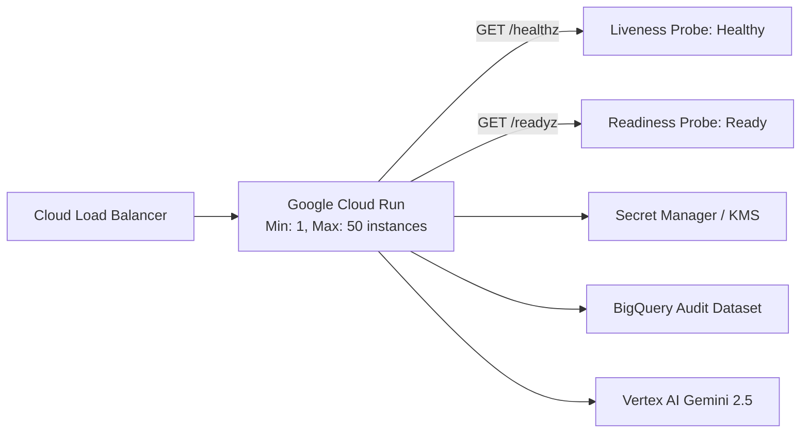
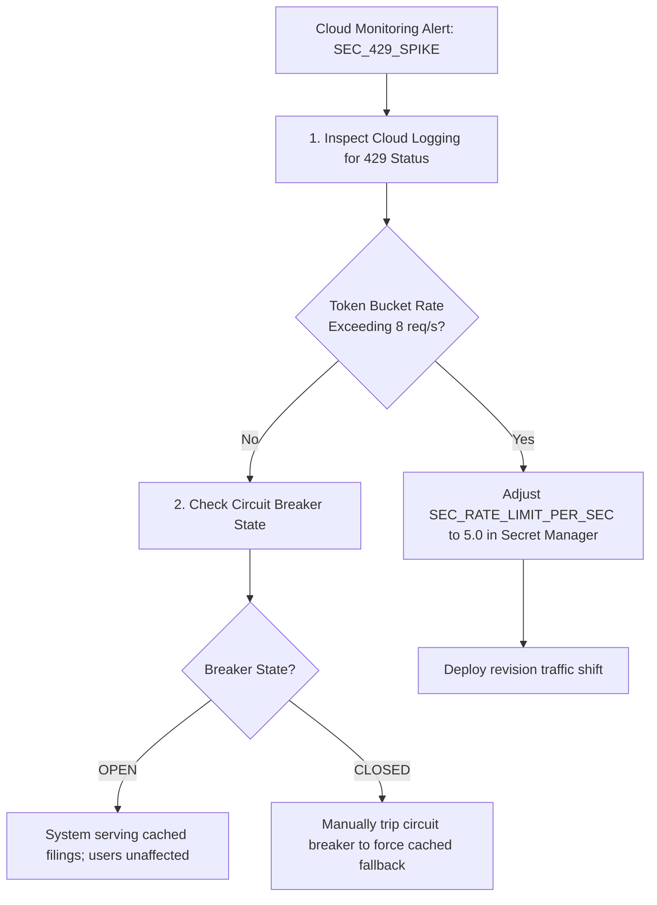

# Operational Runbook
## Autonomous Investment Research Intelligence Agent (IRA)

---

### Document Control
- **Document Version:** 1.0.0
- **Classification:** Enterprise Operational Guide / On-Call SRE Runbook
- **Target Audience:** Site Reliability Engineers (SRE), Cloud Operations, Platform Engineers

---

## 1. System Topology & Operational Health Checks

The IRA service runs as a containerized microservice on Google Cloud Run within a dedicated Virtual Private Cloud (VPC), communicating privately via Serverless VPC Access with Google Cloud APIs (Vertex AI, BigQuery, Secret Manager, Cloud KMS).



### 1.1 Probes & Health Check Endpoints
- **Liveness Endpoint:** `GET /healthz`
  - *Expected Status:* `HTTP 200 OK`
  - *Response Payload:* `{"status": "HEALTHY", "uptime_seconds": 12450.2}`
  - *Failure Action:* Cloud Run automatically restarts the container instance after 3 consecutive failures.
- **Readiness Endpoint:** `GET /readyz`
  - *Expected Status:* `HTTP 200 OK`
  - *Validates:* Database streaming availability, KMS key accessibility, and circuit breaker status.

---

## 2. Routine Maintenance & Secret Rotation

### 2.1 Google Cloud KMS Key Rotation (Every 90 Days)
Cloud KMS customer-managed encryption keys (CMEK) are configured with an automatic 90-day rotation policy (`7776000s`).
To manually verify or force-rotate the KMS crypto key:
```bash
# Verify current primary key version
gcloud kms keys versions list \
    --key=ira-cmek-key \
    --keyring=ira-keyring \
    --location=us-central1

# Manually create a new key version
gcloud kms keys versions create \
    --key=ira-cmek-key \
    --keyring=ira-keyring \
    --location=us-central1

# Promote the new key version to primary
gcloud kms keys set-primary-version ira-cmek-key \
    --keyring=ira-keyring \
    --location=us-central1 \
    --version=<NEW_VERSION_NUMBER>
```

### 2.2 Updating SEC EDGAR User-Agent Compliance Header
Under SEC regulations, automated EDGAR requests must specify a custom User-Agent identifying the
requesting firm and contact administrator.

This is **not** a secret and is not stored in Secret Manager: the string is transmitted in cleartext
in the header of every single request to sec.gov. It is a plain environment variable on the Cloud
Run revision, where an operator debugging a 403 from SEC can read it without an IAM grant.

```bash
gcloud run services update ira-service-production \
    --region=us-central1 \
    --update-env-vars=SEC_EDGAR_USER_AGENT="InstitutionalDesk admin.desk@firm.com"
```

Terraform owns the durable value (`sec_edgar_user_agent` in `terraform.tfvars`); the command above
is the break-glass path. Update both, or the next `terraform apply` reverts it.

> [!IMPORTANT]
> The service refuses to start in live mode if this value is empty, is the sample placeholder, or
> contains no `@` — see `Settings._reject_placeholder_contact_when_live`. The failure is deliberate:
> all egress leaves through a single VPC connector, so an SEC IP ban takes the whole service with it.

---

### 2.3 Calling the API, and what happens when the audience is wrong

The service accepts a Google-signed OIDC identity token and verifies it twice: Cloud Run IAM checks
it before the request reaches the container, and `verify_auth_token` checks signature, issuer,
expiry and **audience** again in-process. Cloud Run forwards the same `Authorization` header it
authenticated with, so both layers see the same token and both are driven from the same Terraform
variable, `custom_audiences`.

Two things about minting the token are worth knowing before the first 401.

**A user account cannot mint a token for an arbitrary audience.** `gcloud auth
print-identity-token --audiences=...` fails for `you@example.com`; the token a user account gets
without `--audiences` carries the gcloud OAuth client as its `aud`, which this service will reject.
The supported route is impersonation, which is why Terraform creates a caller service account
holding `roles/run.invoker` and nothing else.

**The audience is a name, not the URL.** The service URL only exists after the apply that creates
the service, so using it as the audience would mean callers cannot be configured until after
deployment. `custom_audiences` is a stable string chosen up front — Cloud Run continues to accept
the run.app URL as well, but nothing needs to use it.

```bash
AUDIENCE=ira-service-production                     # terraform output accepted_token_audiences
CALLER=$(terraform -chdir=terraform output -raw caller_service_account)
SERVICE_URL=$(gcloud run services describe ira-service-production \
    --region=us-central1 --format="value(status.url)")

TOKEN=$(gcloud auth print-identity-token \
    --impersonate-service-account="${CALLER}" \
    --audiences="${AUDIENCE}")

curl -sS -X POST "${SERVICE_URL}/v1/research/equity" \
    -H "Authorization: Bearer ${TOKEN}" \
    -H "Content-Type: application/json" \
    -d '{"ticker": "AAPL", "fiscal_year": 2024}'
```

Impersonation requires `roles/iam.serviceAccountTokenCreator` on the caller SA — add yourself to the
`token_creator_members` variable. Without it gcloud returns a 403 naming `generateIdToken`.

| Symptom | Cause |
|---|---|
| `403` from Cloud Run, no application log line | IAM. The caller has no `roles/run.invoker`. Add them to `invoker_members` in `terraform.tfvars`. |
| `401 Bearer token failed verification`, with a log line naming the claim | The token reached the app and failed. Almost always the audience: `gcloud auth print-identity-token` without `--audiences` mints one for the gcloud OAuth client, not for this service. |
| Container exits at startup with `ENVIRONMENT=production requires AUTH_ALLOWED_AUDIENCES` | The revision has no audience configured, so it cannot verify anyone. Set `custom_audiences` in `terraform.tfvars` (e.g. `["ira-service-production"]`) and apply; the module sets it on the service and in the container from that one value. |
| Caller gets 401 `Bearer token failed verification.` but IAM shows them as an invoker | Cloud Run admitted a token whose audience the application does not accept. The two lists come from the same `custom_audiences` variable, so this means the caller minted for something else - usually the run.app URL. Either mint for the custom audience, or add the URL to `custom_audiences` and apply. |
| `gcloud auth print-identity-token --audiences=...` fails for a human account | Expected. A user account cannot mint a token for an arbitrary audience. Add `--impersonate-service-account=$(terraform output -raw caller_service_account)`, and make sure the user is in `token_creator_members`. |
| An audit record whose `user_id` starts with `unverified-` | The revision is running the development path. It should not be possible in production; if you see one, that revision was not built from this configuration. |

> [!NOTE]
> The in-process check duplicates work IAM has already done. That is deliberate. IAM decides whether
> the request may enter; the application decides whose name goes in the audit record, and a claim is
> only worth writing down if it was verified where it is written.

---

## 3. Incident Triage & Emergency Response Playbooks

### Incident 3.1: Upstream SEC EDGAR HTTP 429 (Rate Limit Ban)



#### Diagnostic Steps:
1. Query Cloud Logging for upstream rate limit triggers:
   ```sql
   resource.type="cloud_run_revision"
   textPayload=~"UPSTREAM_RATE_LIMIT|429"
   ```
2. Verify token bucket configuration in `Settings`: ensure `sec_rate_limit_per_sec <= 8.0`.
3. Verify that the Circuit Breaker transitioned to `OPEN` and that fallback responses carry the signature `source_status: CACHED_FALLBACK_CIRCUIT_BREAKER_ACTIVE`.

---

### Incident 3.2: Vertex AI Transient 503 Outage

#### Symptoms:
- Spike in 503 status codes from Vertex AI Gemini 2.5 API endpoints.
- End-to-end synthesis latency rises above 50 seconds.

#### Triage Action:
1. Verify Google Cloud Status Dashboard for regional Vertex AI service degradation in `us-central1`.
2. The IRA system automatically applies exponential backoff with full jitter (up to 3 retries).
3. If outage is prolonged (>10 minutes), failover traffic to secondary region (`us-east4`) using Cloud DNS / Multi-Region Cloud Run routing.

---

### Incident 3.3: Elevated Adversarial Injection Spike

#### Symptoms:
- Alert: `GuardrailBlockedRate > 10%` over a 5-minute rolling window.

#### Triage Action:
1. Run BigQuery query to extract malicious IP addresses and prompt fingerprints:
   ```sql
   SELECT user_id, prompt_hash, COUNT(*) as attack_count
   FROM `ira_financial_intelligence.compliance_audit_log`
   WHERE guardrail_verdict = 'REJECT_INJECTION'
     AND timestamp > TIMESTAMP_SUB(CURRENT_TIMESTAMP(), INTERVAL 1 HOUR)
   GROUP BY user_id, prompt_hash
   ORDER BY attack_count DESC;
   ```
2. Blacklist offending IP blocks or IAM user principals in Cloud Armor WAF security policy:
   ```bash
   gcloud compute security-policies rules create 1000 \
       --security-policy=ira-cloud-armor \
       --src-ip-ranges="<OFFENDING_IP_RANGE>" \
       --action="deny-403"
   ```

---

## 4. Disaster Recovery & Context Cache Purge

### 4.1 Purging Stale Gemini Context Caches
If a restatement or amended Form 10-K/A is filed by a company, the in-memory context cache must be purged immediately:
```bash
# List all active cached contents in Vertex AI
gcloud beta ai cached-contents list --location=us-central1

# Delete the specific ticker cache
gcloud beta ai cached-contents delete <CACHE_ID> --location=us-central1
```

### 4.2 Restoring BigQuery Audit Datasets
BigQuery datasets are protected by 7-day Time Travel. To recover an accidentally modified or deleted audit partition:
```sql
CREATE OR REPLACE TABLE `ira_financial_intelligence.compliance_audit_log_restored`
AS SELECT *
FROM `ira_financial_intelligence.compliance_audit_log`
FOR SYSTEM_TIME AS OF TIMESTAMP_SUB(CURRENT_TIMESTAMP(), INTERVAL 1 HOUR);
```

### 4.3 Rolling Back a Blue/Green Deployment

`cloudbuild.yaml` stages each release as a **GREEN** revision with `--no-traffic`, smoke-tests it on
its tagged URL (`/healthz` and `/readyz`), and only then shifts 100% of traffic. Two failure modes:

**Case A - the smoke test failed.** The build aborts before the cutover step. BLUE is still serving
100% of traffic and **no operator action is required**. Read the `smoke-test-green-revision` step
log, fix forward, and re-run the build. The failed GREEN revision remains deployed at zero traffic
and can be inspected via its tagged URL.

**Case B - GREEN passed the smoke test but is misbehaving in production.** Roll back by name:

```bash
# 1. List revisions newest-first; identify the last known-good (previous) revision.
gcloud run revisions list \
    --service=ira-service-production --region=us-central1 \
    --format="table(metadata.name, status.conditions[0].lastTransitionTime, spec.containers[0].image)"

# 2. Send all traffic back to it. Takes effect in seconds; no rebuild, no redeploy.
gcloud run services update-traffic ira-service-production \
    --region=us-central1 \
    --to-revisions=<LAST_KNOWN_GOOD_REVISION>=100

# 3. Confirm the split.
gcloud run services describe ira-service-production \
    --region=us-central1 --format="value(status.traffic)"
```

> Revisions are named `ira-service-production-green-<SHORT_SHA>`, so the offending revision maps
> directly back to its Git commit. Record that SHA in the incident ticket and revert it on `main`
> so the next build does not redeploy the same defect.

**Post-rollback:** the bad revision keeps its `green-<sha>` tag and 0% traffic. Leave it in place
for forensics; Cloud Run retains it at no cost while it serves no requests.

---

## 5. Switching Between Fixture and Live SEC Data

The SEC ingestion path has two modes, selected by the `OFFLINE_MODE` environment variable.

| | `OFFLINE_MODE=true` (default) | `OFFLINE_MODE=false` |
|---|---|---|
| Source | Bundled fixtures | Live `sec.gov` / `data.sec.gov` |
| Network | None | Outbound HTTPS |
| Determinism | Fully deterministic | Varies with filings and restatements |
| Used by | Tests, CI, evaluation gate | Production research |

### 5.1 Before enabling live mode

1. **Set a real `SEC_EDGAR_USER_AGENT`.** It must contain an organisation name and a working
   contact address. SEC throttles anonymous callers and then blocks the source IP. `Settings`
   refuses to construct with `OFFLINE_MODE=false` if the value is blank, is the sample placeholder,
   or has no `@` in it — but it cannot tell whether the mailbox is real.
2. **Confirm egress.** Cloud Run runs with `--vpc-egress all-traffic`, so the VPC must have a NAT
   route to the public internet or every SEC call will time out and trip the circuit breaker.
3. **Expect the evaluation gate to drift.** Golden answers were recorded against fixtures. Run the
   gate against live data in a scratch environment before trusting its verdict.

### 5.2 Reading the provenance label

Every filing response carries a `data_source` field. Check it when a figure looks wrong:

| `data_source` | Meaning |
|---|---|
| `SEC_EDGAR_LIVE` | Read from the registrant's XBRL tags. Trustworthy. |
| `OFFLINE_FIXTURE` | Curated fixture transcribed from a real filing. Accurate but frozen in time. |
| `OFFLINE_SYNTHETIC_PLACEHOLDER` | **Invented placeholder numbers.** Never cite these. Appears when an unknown ticker is requested in offline mode. |
| `CACHED_FALLBACK_CIRCUIT_BREAKER_ACTIVE` | Live fetch failed; serving cached data. Investigate upstream. |

> [!CAUTION]
> If a production brief comes back with `OFFLINE_SYNTHETIC_PLACEHOLDER`, the service is running in
> offline mode when it should not be. `GET /readyz` reports `runtime.offline_mode` directly, so this
> is one request rather than an inspection of the revision's environment.

### 5.3 Reverting to fixtures

Set `OFFLINE_MODE=true` and deploy. No code change and no data migration; the switch is read per
request from settings, so the next revision picks it up immediately.
