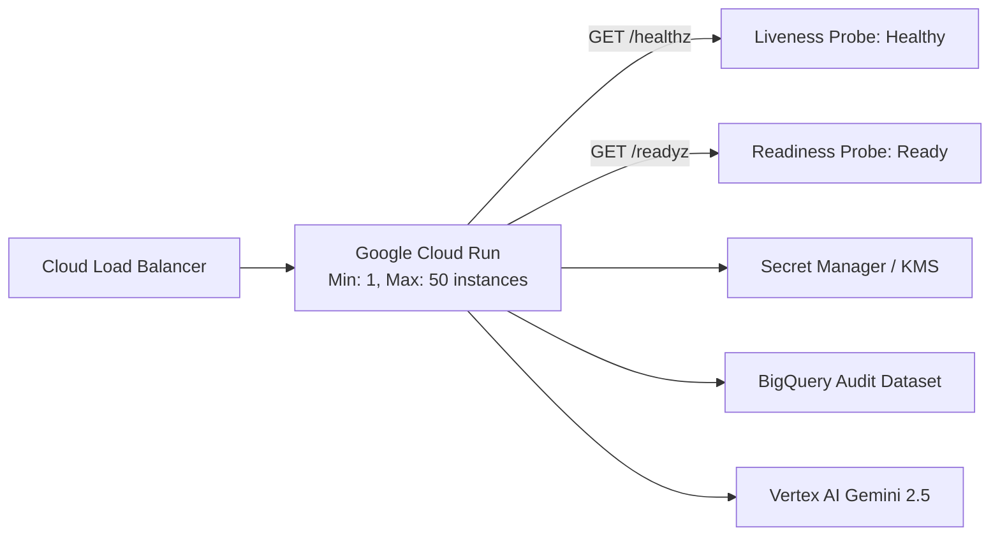
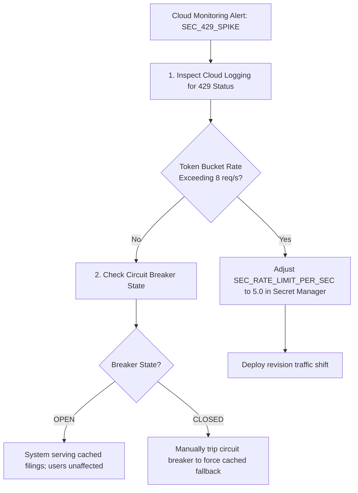

# Operational Runbook
## Autonomous Investment Research Intelligence Agent (IRA)

---

### Document Control
- **Document Version:** 1.0.0
- **Classification:** Enterprise Operational Guide / On-Call SRE Runbook
- **Target Audience:** Site Reliability Engineers (SRE), Cloud Operations, Platform Engineers

---

## 1. System Topology & Operational Health Checks

The IRA service runs as a containerized microservice on Google Cloud Run within a dedicated Virtual Private Cloud (VPC), communicating privately via Serverless VPC Access with Google Cloud APIs (Vertex AI, BigQuery, Secret Manager, Cloud KMS).



### 1.1 Probes & Health Check Endpoints
- **Liveness Endpoint:** `GET /healthz`
  - *Expected Status:* `HTTP 200 OK`
  - *Response Payload:* `{"status": "HEALTHY", "uptime_seconds": 12450.2}`
  - *Failure Action:* Cloud Run automatically restarts the container instance after 3 consecutive failures.
- **Readiness Endpoint:** `GET /readyz`
  - *Expected Status:* `HTTP 200 OK`
  - *Validates:* Database streaming availability, KMS key accessibility, and circuit breaker status.

---

## 2. Routine Maintenance & Secret Rotation

### 2.1 Google Cloud KMS Key Rotation (Every 90 Days)
Cloud KMS customer-managed encryption keys (CMEK) are configured with an automatic 90-day rotation policy (`7776000s`).
To manually verify or force-rotate the KMS crypto key:
```bash
# Verify current primary key version
gcloud kms keys versions list \
    --key=ira-cmek-key \
    --keyring=ira-keyring \
    --location=us-central1

# Manually create a new key version
gcloud kms keys versions create \
    --key=ira-cmek-key \
    --keyring=ira-keyring \
    --location=us-central1

# Promote the new key version to primary
gcloud kms keys set-primary-version ira-cmek-key \
    --keyring=ira-keyring \
    --location=us-central1 \
    --version=<NEW_VERSION_NUMBER>
```

### 2.2 Updating SEC EDGAR User-Agent Compliance Header
Under SEC regulations, automated EDGAR requests must specify a custom User-Agent identifying the requesting firm and contact administrator.
To update this credential in Google Secret Manager without service redeployment:
```bash
# Add a new version of the SEC contact header
echo -n "InstitutionalDesk admin.desk@firm.com" | \
    gcloud secrets versions add ira-sec-edgar-contact --data-file=-
```

---

## 3. Incident Triage & Emergency Response Playbooks

### Incident 3.1: Upstream SEC EDGAR HTTP 429 (Rate Limit Ban)



#### Diagnostic Steps:
1. Query Cloud Logging for upstream rate limit triggers:
   ```sql
   resource.type="cloud_run_revision"
   textPayload=~"UPSTREAM_RATE_LIMIT|429"
   ```
2. Verify token bucket configuration in `Settings`: ensure `sec_rate_limit_per_sec <= 8.0`.
3. Verify that the Circuit Breaker transitioned to `OPEN` and that fallback responses carry the signature `source_status: CACHED_FALLBACK_CIRCUIT_BREAKER_ACTIVE`.

---

### Incident 3.2: Vertex AI Transient 503 Outage

#### Symptoms:
- Spike in 503 status codes from Vertex AI Gemini 2.5 API endpoints.
- End-to-end synthesis latency rises above 50 seconds.

#### Triage Action:
1. Verify Google Cloud Status Dashboard for regional Vertex AI service degradation in `us-central1`.
2. The IRA system automatically applies exponential backoff with full jitter (up to 3 retries).
3. If outage is prolonged (>10 minutes), failover traffic to secondary region (`us-east4`) using Cloud DNS / Multi-Region Cloud Run routing.

---

### Incident 3.3: Elevated Adversarial Injection Spike

#### Symptoms:
- Alert: `GuardrailBlockedRate > 10%` over a 5-minute rolling window.

#### Triage Action:
1. Run BigQuery query to extract malicious IP addresses and prompt fingerprints:
   ```sql
   SELECT user_id, prompt_hash, COUNT(*) as attack_count
   FROM `ira_financial_intelligence.compliance_audit_log`
   WHERE guardrail_verdict = 'REJECT_INJECTION'
     AND timestamp > TIMESTAMP_SUB(CURRENT_TIMESTAMP(), INTERVAL 1 HOUR)
   GROUP BY user_id, prompt_hash
   ORDER BY attack_count DESC;
   ```
2. Blacklist offending IP blocks or IAM user principals in Cloud Armor WAF security policy:
   ```bash
   gcloud compute security-policies rules create 1000 \
       --security-policy=ira-cloud-armor \
       --src-ip-ranges="<OFFENDING_IP_RANGE>" \
       --action="deny-403"
   ```

---

## 4. Disaster Recovery & Context Cache Purge

### 4.1 Purging Stale Gemini Context Caches
If a restatement or amended Form 10-K/A is filed by a company, the in-memory context cache must be purged immediately:
```bash
# List all active cached contents in Vertex AI
gcloud beta ai cached-contents list --location=us-central1

# Delete the specific ticker cache
gcloud beta ai cached-contents delete <CACHE_ID> --location=us-central1
```

### 4.2 Restoring BigQuery Audit Datasets
BigQuery datasets are protected by 7-day Time Travel. To recover an accidentally modified or deleted audit partition:
```sql
CREATE OR REPLACE TABLE `ira_financial_intelligence.compliance_audit_log_restored`
AS SELECT *
FROM `ira_financial_intelligence.compliance_audit_log`
FOR SYSTEM_TIME AS OF TIMESTAMP_SUB(CURRENT_TIMESTAMP(), INTERVAL 1 HOUR);
```

### 4.3 Rolling Back a Blue/Green Deployment

`cloudbuild.yaml` stages each release as a **GREEN** revision with `--no-traffic`, smoke-tests it on
its tagged URL (`/healthz` and `/readyz`), and only then shifts 100% of traffic. Two failure modes:

**Case A - the smoke test failed.** The build aborts before the cutover step. BLUE is still serving
100% of traffic and **no operator action is required**. Read the `smoke-test-green-revision` step
log, fix forward, and re-run the build. The failed GREEN revision remains deployed at zero traffic
and can be inspected via its tagged URL.

**Case B - GREEN passed the smoke test but is misbehaving in production.** Roll back by name:

```bash
# 1. List revisions newest-first; identify the last known-good (previous) revision.
gcloud run revisions list \
    --service=ira-multiagent-service --region=us-central1 \
    --format="table(metadata.name, status.conditions[0].lastTransitionTime, spec.containers[0].image)"

# 2. Send all traffic back to it. Takes effect in seconds; no rebuild, no redeploy.
gcloud run services update-traffic ira-multiagent-service \
    --region=us-central1 \
    --to-revisions=<LAST_KNOWN_GOOD_REVISION>=100

# 3. Confirm the split.
gcloud run services describe ira-multiagent-service \
    --region=us-central1 --format="value(status.traffic)"
```

> Revisions are named `ira-multiagent-service-green-<SHORT_SHA>`, so the offending revision maps
> directly back to its Git commit. Record that SHA in the incident ticket and revert it on `main`
> so the next build does not redeploy the same defect.

**Post-rollback:** the bad revision keeps its `green-<sha>` tag and 0% traffic. Leave it in place
for forensics; Cloud Run retains it at no cost while it serves no requests.
