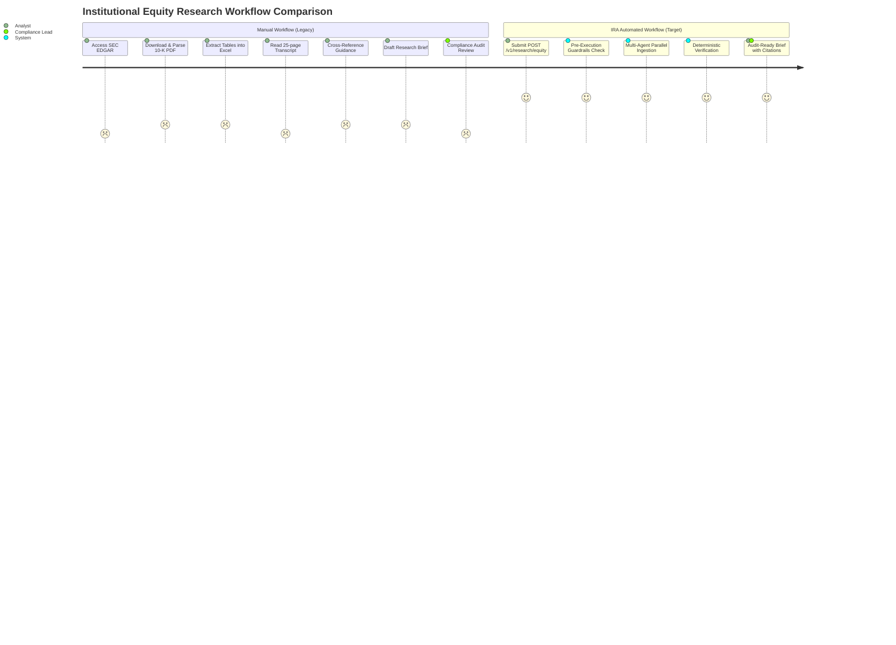
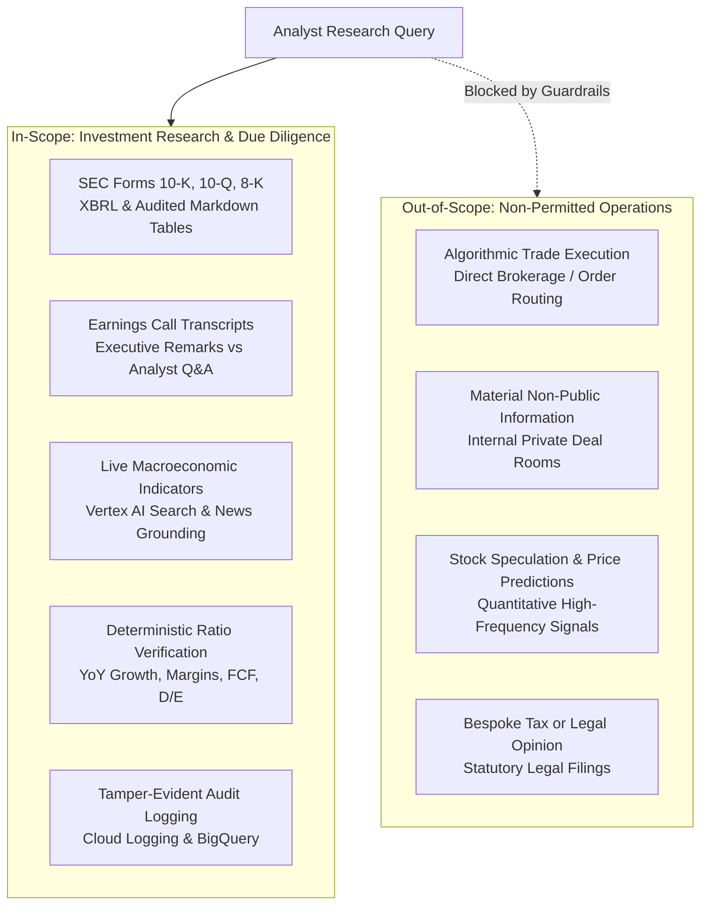

# Functional Requirements Document (FRD / PRD)
## Autonomous Investment Research Intelligence Agent (IRA)

---

### Document Control & Metadata
- **Project Name:** Autonomous Investment Research Intelligence Agent (IRA)
- **Document Version:** 1.0.0
- **Classification:** Enterprise Confidential / Financial Systems Spec
- **Target Platform:** Google Cloud Platform (Vertex AI, Google Agent Development Kit, Cloud Run, BigQuery, Cloud DLP, Cloud Trace)
- **Evaluation Framework:** CPSE-to-FDE Readiness Assessment (AI Well-Architected Framework)

---

## 1. Executive Summary & Business Context

### 1.1 Problem Statement
In institutional buy-side asset management firms, hedge funds, and investment banking equity research desks, financial analysts spend over **50% of their billable hours** performing manual data aggregation across fragmented corporate repositories. An in-depth quarterly equity research brief requires an analyst to:
1. Search regulatory portals (SEC EDGAR) for audited Form 10-K, 10-Q, and 8-K filings.
2. Manually cross-reference dense financial statements (Income Statement, Balance Sheet, Cash Flow) across consecutive fiscal years.
3. Review 20+ page quarterly earnings call transcripts to decipher executive sentiment, forward guidance, and analyst Q&A nuances.
4. Monitor real-time macroeconomic news feeds and interest rate announcements.

### 1.2 Operational Bottlenecks & Drag
- **High Synthesis Latency:** Manually extracting and reconciling multi-page audited financial disclosures with qualitative commentary takes **3 to 6 hours per company per quarter**.
- **Hallucination Risk & Missing Provenance:** General-purpose Large Language Models (LLMs) hallucinate numerical disclosures or rely on stale training data, rendering outputs unviable for institutional compliance and investment committees.
- **Information Fragmentation:** Analysts juggle SEC EDGAR, transcript portals, and news terminals, frequently missing qualitative risk disclosures (Item 1A) and footnote adjustments.

### 1.3 Solution Overview
The **Autonomous Investment Research Intelligence Agent (IRA)** is an enterprise multi-agent system built on Google Cloud Platform using the Google Agent Development Kit (ADK) and Gemini 2.5 Pro. It automates equity due diligence by orchestrating specialized sub-agents across audited regulatory filings, earnings call transcripts, and live market intelligence. The system produces audit-ready research briefs with **100% line-item citation provenance** in **under 60 seconds**.

---

## 2. Target Personas & User Journeys

### 2.1 Target Personas

| Persona | Role & Objectives | Key Pain Points | System Value Proposition |
|---|---|---|---|
| **Institutional Equity Analyst** | Performs deep fundamental analysis on coverage universe (20-30 tickers); builds financial models and quarterly previews. | Excessive time spent copying tables from SEC filings; manual transcript scouring. | Accelerates quarterly synthesis from 4 hours to <60 seconds with verified XBRL tables and quotes. |
| **Portfolio Manager (PM)** | Allocates capital across portfolio strategies; evaluates analyst theses and requires rapid risk assessments. | Delayed synthesis means missed market reaction windows; skepticism toward unverified AI outputs. | High-conviction briefs with instant audit trails and line-item source links. |
| **Risk & Compliance Officer** | Enforces regulatory compliance (FINRA, SEC, SOX); ensures research notes have verifiable audit trails and no non-public data leaks. | AI hallucinations create regulatory exposure; lack of tamper-evident query logging. | 100% evidentiary provenance, Cloud DLP redaction, and tamper-evident BigQuery audit logging. |

---

## 3. Baseline vs. Target Workflow Metrics & ROI

| Performance Dimension | Baseline Manual Workflow | Legacy GenAI Workflow | Target IRA System | Business Impact & ROI |
|---|---|---|---|---|
| **End-to-End Synthesis Latency** | 180 – 360 minutes | 3 – 5 minutes (incomplete) | **< 60 seconds (P95)** | **> 90% reduction in research preparation time** |
| **Numerical Accuracy & Groundedness** | High (human verified) | Medium (15-25% hallucination) | **100% Grounded (Score: 1.0)** | Eliminates hallucination risk on primary financials |
| **Evidentiary Provenance** | Manual footnote referencing | Unverifiable / Stale URL citations | **100% Line-Item Provenance** | Line, table, row, and transcript timestamp citations |
| **Operational Cost per Brief** | $150 – $300 (billable labor) | $1.50 – $3.00 (brute token burn) | **< $0.25 per Brief** | > 85% token cost reduction via Gemini Context Caching |
| **Compliance Audit Trail** | Disjointed spreadsheets & notes | Unlogged API prompts | **Tamper-evident BQ Audit Log** | Immediate compliance sign-off; full query reproducibility |

---

## 4. System Boundaries: In-Scope vs. Out-of-Scope

### 4.1 In-Scope Capabilities
- Ingestion, parsing, and normalization of SEC public EDGAR filings (10-K, 10-Q, 8-K) via Model Context Protocol (MCP).
- Quarterly earnings call transcript segmentation distinguishing formal executive prepared remarks from analyst Q&A.
- Real-time web search grounding for macroeconomic context (interest rates, central bank announcements, industry trends).
- Deterministic calculation of fundamental financial ratios using Python numerical execution (zero LLM calculation).
- Structured output rendering conforming strictly to Pydantic v2 schemas with line-item citations.
- Pre-execution guardrails intercepting prompt injection, jailbreaks, and out-of-domain requests.
- Full distributed tracing via OpenTelemetry and compliance audit logging to Google Cloud Logging & BigQuery.

### 4.2 Out-of-Scope Capabilities
- **Trade Execution:** The system shall NOT connect to order routing systems or execute trades.
- **Material Non-Public Information (MNPI):** The system shall strictly process public disclosures and shall reject proprietary or confidential deal room ingestion.
- **Stock Price Prediction:** The system shall NOT generate quantitative price targets, trading advice, or speculative price forecasts.
- **Tax and Legal Counsel:** The system outputs fundamental equity research briefs, not legal or formal tax advisory opinions.

---

## 5. Functional Requirements

### FR-1: Pre-Execution Security & Input Guardrailing
- The system shall inspect all incoming requests before dispatching to LLMs.
- Queries containing adversarial prompt injection syntax (e.g., "ignore prior instructions", "system prompt override") must be rejected immediately with HTTP 400 and logged as security violations.
- Queries outside financial equity research (e.g., creative writing, code generation, stock price gambling) must be rejected with an out-of-domain explanation.
- Cloud DLP inspection shall mask client identifiers and proprietary portfolio metadata before runtime processing.

### FR-2: Root Coordinator Reasoning & Dynamic Planning
- The Root Coordinator Agent shall use Gemini 2.5 Pro with explicit thought budgeting to evaluate analyst queries.
- The coordinator shall formulate a structured multi-step execution plan specifying required sub-agent tasks and dispatch them concurrently using asynchronous I/O.

### FR-3: SEC EDGAR Filing Retrieval & Parsing (MCP)
- The SEC Sub-Agent shall interface with the SEC EDGAR MCP server complying with SEC rate limits (10 req/s with custom `User-Agent`).
- The agent shall extract Consolidated Balance Sheets, Statements of Operations, Statements of Cash Flows, and Item 7 (MD&A).
- Tables shall be normalized into clean markdown representations paired with exact XBRL line-item metadata tags.

### FR-4: Earnings Call Transcript Analysis
- The Transcript Sub-Agent shall ingest quarterly transcripts and parse them into discrete sections:
  1. *Executive Prepared Remarks* (CEO / CFO strategy, margin commentary, guidance).
  2. *Analyst Q&A* (unscripted responses, analyst pushback, regional headwinds).
- Sentiment and qualitative tone must be extracted with speaker attribution and timestamp references.

### FR-5: Macroeconomic & Live News Grounding
- The Macro Sub-Agent shall query Vertex AI Search and Google Search Grounding for real-time market updates, central bank policy announcements, and competitor developments.
- All news snippets must include verifiable source domains and publication timestamps.

### FR-6: Deterministic Financial Ratio Verification
- Financial ratios shall NOT be calculated by LLM text generation.
- A pure Python calculation tool (`FinancialCalculator`) shall ingest primary numerical figures and compute:
  1. Year-over-Year (YoY) Revenue Growth Rate (%).
  2. Operating Margin Current (%) and Compression/Expansion (bps).
  3. Free Cash Flow Conversion Ratio (%).
  4. Total Debt-to-Equity Ratio.
- All calculations must retain four-decimal-place precision before presentation rounding.

### FR-7: Evidentiary Line-Item Provenance Assertion
- 100% of numerical values, executive quotes, and qualitative statements presented in the final brief must be accompanied by an `EvidentiaryCitation` object containing:
  - Source document type (Form 10-K, 10-Q, Transcript, News).
  - Fiscal period and accession number / publication date.
  - Exact table name, row header, column header, or verbatim sentence quote.

### FR-8: Structured Output & Gateway Delivery
- The API gateway shall validate that the final payload conforms strictly to the `ResearchBriefResponse` Pydantic v2 schema.
- Unstructured markdown dumps without schema conformance shall be intercepted and rejected.

---

## 6. Non-Functional Requirements (NFRs)

| ID | Category | Requirement Description | Target Threshold |
|---|---|---|---|
| **NFR-1** | **Performance** | End-to-end latency for a multi-source research brief synthesis across 10-K, transcript, and macro news. | **$\le$ 60 seconds (P95)** |
| **NFR-2** | **Accuracy** | Faithfulness and groundedness score on financial figures evaluated against primary filings. | **1.0 (Zero Hallucination)** — *currently measured at 0.60 / 4.5% coverage; NOT MET, see DEV-15* |
| **NFR-3** | **Citation Quality** | Verifiable citation precision rate for all stated financial metrics. | **100% Verifiable** |
| **NFR-4** | **Availability** | Production API service availability deployed across Google Cloud Run. | **$\ge$ 99.9% Uptime** |
| **NFR-5** | **Cost Efficiency** | Total inference token cost per synthesized research brief utilizing Gemini Context Caching. | **$\le$ $0.25 per Brief** |
| **NFR-6** | **Code Coverage** | Automated unit, integration, and guardrail test suite code coverage. | **$\ge$ 80% Coverage** |

---

## 7. Definition of Done (DoD)
A feature or release candidate is considered Done when:
1. All automated unit and integration tests pass with $\ge 80\%$ statement coverage.
2. The Golden Evaluation Dataset (50+ scenarios) executes with Faithfulness = 1.0, Relevance $\ge 0.90$, and Citation Precision = 100%.
3. 100% of cloud resources are codified in declarative Terraform scripts.
4. Pre-execution guardrails intercept 100% of test jailbreaks and prompt injection attempts.
5. All commits follow Conventional Commits and pass CI/CD linting, static typing (MyPy), and security scans.
