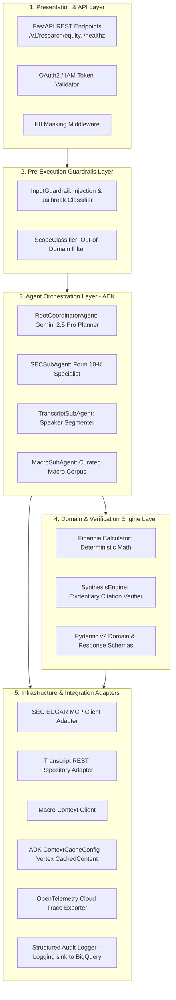

# Technical Design Document (TDD) — Part 2: Application Architecture
## Autonomous Investment Research Intelligence Agent (IRA)

---

### Document Control
- **Document Version:** 1.0.0
- **Language & Runtime:** Python 3.13 / FastAPI / Pydantic v2
- **Patterns:** Dependency Injection, Repository Pattern, Strategy Pattern, Adapter Pattern

---

## 1. Application Layering & Separation of Concerns

The IRA application architecture follows Clean Architecture principles, ensuring that domain logic and agent planning reasoning are fully decoupled from infrastructure dependencies (cloud databases, external APIs, and transport protocols).



---

## 2. Core Interface Abstractions (Abstract Base Classes)

All components communicate through typed abstract interfaces defined in `src/core/interfaces.py`, enabling complete test mocking and backend provider swappability without modifying core business logic.

```python
# src/core/interfaces.py
from abc import ABC, abstractmethod
from typing import Dict, Any, List, Optional
from src.models.request import EquityResearchRequest
from src.models.response import ResearchBriefResponse, FinancialMetric, EvidentiaryCitation

class BaseAgent(ABC):
    """Abstract base class for all autonomous agents in the multi-agent system."""

    @abstractmethod
    async def run(self, context: Dict[str, Any]) -> Dict[str, Any]:
        """Execute agent reasoning loop or task extraction."""
        pass

class BaseTool(ABC):
    """Abstract base class for all deterministic and external tools."""

    @property
    @abstractmethod
    def name(self) -> str:
        """Unique identifier of the tool."""
        pass

    @property
    @abstractmethod
    def description(self) -> str:
        """Human-readable and LLM-consumable tool description."""
        pass

    @abstractmethod
    async def execute(self, **kwargs) -> Any:
        """Execute tool logic."""
        pass

class FilingRetrievalInterface(ABC):
    """Interface for SEC filing retrieval backends (MCP vs REST vs Mock)."""

    @abstractmethod
    async def fetch_filing_section(self, ticker: str, form: str, fiscal_year: int, section: str) -> Dict[str, Any]:
        pass

class MarketDataInterface(ABC):
    """Interface for macroeconomic and market news grounding backends."""

    @abstractmethod
    async def query_market_context(self, ticker: str, focus_areas: List[str]) -> List[Dict[str, Any]]:
        pass

class GuardrailInterface(ABC):
    """Interface for pre-execution security and safety classifiers."""

    @abstractmethod
    def validate_input(self, prompt: str) -> bool:
        pass
```

---

## 3. Dependency Injection (DI) Container

The application employs a lightweight, explicit Dependency Injection container (`src/core/container.py`) to manage singleton lifecycles, configuration injection, and mock substitution for testing:

```python
# src/core/container.py
from typing import Optional
from src.config import Settings
from src.tools.financial_calculator import FinancialCalculator
from src.tools.sec_edgar_mcp import SECFilingClient
from src.tools.transcript_parser import TranscriptClient
from src.tools.macro_context import MacroContextClient
from src.engine.synthesis_engine import SynthesisEngine
from src.agents.root_coordinator import RootCoordinatorAgent
from src.agents.sec_agent import SECSubAgent
from src.agents.transcript_agent import TranscriptSubAgent
from src.agents.macro_agent import MacroSubAgent
from src.guardrails.input_guardrail import InputGuardrail

class ApplicationContainer:
    """Dependency Injection container assembling application graph."""

    def __init__(self, settings: Optional[Settings] = None):
        self.settings = settings or Settings()

        # Tools & Adapters
        self.calculator = FinancialCalculator()
        self.sec_client = SECFilingClient(settings=self.settings)
        self.transcript_client = TranscriptClient(settings=self.settings)
        self.search_client = MacroContextClient(settings=self.settings)

        # Guardrails
        self.guardrail = InputGuardrail(settings=self.settings)

        # Specialized Sub-Agents
        self.sec_agent = SECSubAgent(client=self.sec_client, settings=self.settings)
        self.transcript_agent = TranscriptSubAgent(client=self.transcript_client, settings=self.settings)
        self.macro_agent = MacroSubAgent(client=self.search_client, settings=self.settings)

        # Synthesis Engine
        self.synthesis_engine = SynthesisEngine(calculator=self.calculator, settings=self.settings)

        # Root Coordinator
        self.root_coordinator = RootCoordinatorAgent(
            sec_agent=self.sec_agent,
            transcript_agent=self.transcript_agent,
            macro_agent=self.macro_agent,
            calculator=self.calculator,
            synthesis_engine=self.synthesis_engine,
            settings=self.settings
        )
```

---

## 4. Domain Exception Hierarchy

Domain-specific exceptions (`src/core/exceptions.py`) provide clear error isolation, preventing unhandled runtime crashes and translating internal states into standardized RFC 7807 HTTP error envelopes:

```python
# src/core/exceptions.py
class FinancialAgentException(Exception):
    """Base exception for all domain errors."""
    def __init__(self, message: str, status_code: int = 500):
        super().__init__(message)
        self.message = message
        self.status_code = status_code

class SecurityViolationException(FinancialAgentException):
    """Raised when prompt injection, jailbreak, or unauthorized input is detected."""
    def __init__(self, message: str):
        super().__init__(message=message, status_code=400)

class OutOfDomainQueryException(FinancialAgentException):
    """Raised when prompt is outside financial equity research scope."""
    def __init__(self, message: str):
        super().__init__(message=message, status_code=400)

class FilingNotFoundException(FinancialAgentException):
    """Raised when an SEC filing or fiscal year is unavailable."""
    def __init__(self, ticker: str, form: str, fiscal_year: int):
        super().__init__(
            message=f"Filing not found for ticker '{ticker}', form '{form}', year {fiscal_year}",
            status_code=404
        )

class UpstreamRateLimitException(FinancialAgentException):
    """Raised when upstream SEC or external provider returns 429 after retries."""
    def __init__(self, service: str):
        super().__init__(
            message=f"Upstream provider '{service}' rate limit reached. Circuit breaker engaged.",
            status_code=429
        )
```
